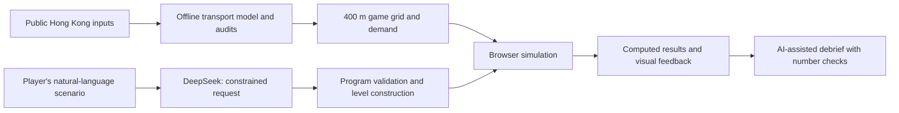

# TransitLab HK

**Learn Hong Kong transport planning by playing — then explore your own scenario with AI.**

Hack for SDGs 2026 · Green Transport & Smart Mobility · Final submission: 18 October 2026

[中文说明](README.zh-CN.md) · [Judges: start here](docs/judges/README.md) · [Technical evidence](docs/judges/technical-evidence.md) · [Final source & run locally](submission/README.md)

## Try it first

| Entry | What to do |
|---|---|
| **[Play the first level](http://43.128.15.246/feeder/mode1-bus/index.html#map=l1)** | Read the short introduction, place three feeder stops, and observe walking distance, demand splitting and limited capacity. No sign-up is needed to enter this level. |
| **[Explore the Hong Kong sandbox](http://43.128.15.246/feeder/mode5-sandbox/)** | Change a district or draw a line, run the simulation, and inspect the before/after results. |
| [All five modes](http://43.128.15.246/feeder/) | Choose a mode on the Hong Kong map. Use **EN** in the language selector for English. |
| [No-sign-up backup demos](http://43.128.15.246/feeder/demo-static/) | Separate presentation demos; modes 1 and 4 are interactive, while other backup pages are explanatory. These are not substitutes for the complete prototype. |

If the live server is unavailable, [run the preserved final package locally](submission/README.md#run-locally), or download the backup pages. Accounts support saved identity and leaderboard submission; reviewers can begin with the direct first-level link or backup demos.

## What is the project?

Transport decisions connect walking access, public-transport service, congestion and land development. TransitLab makes these relationships visible through five progressively richer experiences, grounded in a Hong Kong data/model foundation.

| Mode | The question the player explores |
|---|---|
| **01 · Stations & walking** | Where should feeder stops go when walking distance, queues and bus capacity matter? |
| **02 · The metro** | How do line design, stations, trains and a limited budget affect ridership? |
| **03 · Roads that jam** | How can changing public transport alter congestion and subsequent travel choices? |
| **04 · Station-side development** | How do rail accessibility, housing and commercial development interact? |
| **05 · Hong Kong sandbox** | What changes when a player explores their own population, jobs or transport scenario? |

The intended use is learning and exploratory comparison. Game scores and simulated changes are **not validated forecasts of real-world policy impact**.

## How it works

- **Data/model foundation:** census, buildings, transport surveys, roads and timetables are processed into zone-level demand, travel times and network results. [Follow the evidence chain.](docs/judges/technical-evidence.md)
- **Interactive engine:** the browser uses simplified rules and a prepared Hong Kong baseline. It does not rerun the complete offline model at every click.
- **GenAI:** server-side DeepSeek turns a sentence into a bounded scenario request and can explain computed results. The program validates requests and checks numbers in debriefs. Without the AI service, labelled predefined examples are available; those are not live generations.

## Review in five minutes

1. [Try one feeder level, then one sandbox scenario.](docs/judges/README.md#suggested-review-route)
2. [See the specific GenAI role and its boundaries.](docs/judges/README.md#what-genai-does)
3. [Trace sources → model → game and inspect limitations.](docs/judges/technical-evidence.md)
4. [Browse the exact deployed-package source](submission/final-2026-10-18/) and [verify it against the uploaded ZIP](submission/README.md#verify-the-package).

The [judges' guide](docs/judges/README.md) connects the evidence to the competition's five equally weighted criteria: problem framing, prototype/demo, appropriate GenAI, feasibility/impact, and sustainability/ethics. It distinguishes demonstrated functionality from planned evaluation.

## Which files are current?

| Path | Purpose |
|---|---|
| **[`submission/final-2026-10-18/`](submission/final-2026-10-18/)** | Current final deployment package, expanded byte-for-byte from `Final.zip`: five-mode site, backend, accounts, leaderboard, deployment templates and backup demos. Start here to review the final app. |
| [`Final.zip`](Final.zip) + [`submission/manifest.json`](submission/manifest.json) | Original submitted archive and its version/file checksums. |
| [`pipeline/`](pipeline/) · [`data/model/`](data/model/) · [`data/web/`](data/web/) | Offline model, saved results and audit evidence behind the game baseline. |
| [`game-feeder/tools/hk-grid/`](game-feeder/tools/hk-grid/) | Conversion from the offline foundation to the Hong Kong game grid. |
| [`game-feeder/v7/`](game-feeder/v7/) | Earlier development source and tooling. It differs from the final deployment package; do not confuse their launch instructions. |
| [`docs/history/`](docs/history/) | Earlier directions, superseded demos and the preserved previous homepage. Optional background, not the review route. |

Large statutory-plan inputs and the land-use cache are already available in the [data Release](https://github.com/Senpagavv/transitlab-hk/releases/tag/base-2026-09-26). Reviewers do not need to download them to play the final app. [Data coverage, trust levels and reproduction options](docs/judges/technical-evidence.md#data-delivery-and-reproduction) explain the distinction.

## Evidence and limits

Official inputs, calibrated estimates, inference and illustrative assumptions are distinguished at field level. The game baseline includes **455 internal zones**; the offline model also contains **15 external/boundary endpoints**. A 400 m display and simplified behavioural rules cannot support street-level engineering conclusions. Baseline audit checks include known limitations; an audit pass count is not an accuracy percentage. [Read the current evidence and limits.](docs/judges/technical-evidence.md#validation-and-known-limits)

Data attribution and third-party terms remain applicable: [source catalogue](docs/data-sources.md), [reuse and references](docs/reuse-and-references.md), and the source metadata in the [game grid](submission/final-2026-10-18/game-feeder/v7-deploy/hk/). OpenStreetMap-derived data requires its applicable attribution/ODbL treatment; public access is not a new blanket licence for all source material.

---

For maintainers: [team onboarding](docs/onboarding.en.md) · [current repository handoff](docs/handoff.md) · [change log](CHANGELOG.md) · [AI contributor instructions](AGENTS.md).
