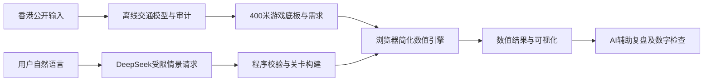

# TransitLab HK

**通过游戏理解香港交通规划，再用 AI 探索自己的情景。**

Hack for SDGs 2026 · 绿色交通与智慧出行赛道 · 最终提交：2026 年 10 月 18 日

[English](README.md) · [评委从这里开始](docs/judges/README.zh-CN.md) · [技术与数据证据](docs/judges/technical-evidence.zh-CN.md) · [最终源码与本地启动](submission/README.md)

## 先体验

| 入口 | 可以看什么 |
|---|---|
| **[直接玩第一关](http://43.128.15.246/feeder/mode1-bus/index.html#map=l1)** | 看简短说明，放三座接驳站，观察步行距离、需求分流和有限运力；进入这一关无需注册。 |
| **[打开全港沙盘](http://43.128.15.246/feeder/mode5-sandbox/)** | 改一个地区或画一条线，运行后比较结果。 |
| [五模式总入口](http://43.128.15.246/feeder/) | 在香港地图上选玩法，顶部可切换繁体、简体与英文。 |
| [无需注册的备用演示](http://43.128.15.246/feeder/demo-static/) | 为演讲准备的独立演示；第一、四关可交互，其他备用页主要用于说明，不能等同完整原型。 |

服务器无法访问时，可[在本机运行保留的最终包](submission/README.md#run-locally)，或下载其中的备用演示。账号支持身份和排行榜提交；评委可先从第一关直达链接或备用演示开始。

## 最终项目是什么

交通规划需要同时考虑步行、公共交通服务、拥堵和土地开发。TransitLab 用五个逐步深入的玩法，让这些关系变得可观察、可操作，并以香港数据和模型提供背景。

| 模式 | 玩家探索的问题 |
|---|---|
| **01 车站与步行** | 步行距离、排队和巴士容量有限时，接驳站应该放在哪？ |
| **02 地铁** | 线路、车站、列车和有限预算怎样影响乘客选择？ |
| **03 路会塞** | 公共交通变化怎样影响拥堵，拥堵又怎样改变下一轮选择？ |
| **04 站旁开发** | 轨道可达性、住宅和商业开发怎样互相影响？ |
| **05 全港沙盘** | 调整人口、岗位或交通方案后，会出现什么模拟变化？ |

用途是学习和情景比较。游戏分数、模拟减少的车辆等，**不是已经验证的现实政策成效预测**。

## 技术怎样连接

- **数据与模型底座：**普查、建筑、出行调查、道路和时刻表形成分区需求、出行时间与网络结果。[查看证据链。](docs/judges/technical-evidence.zh-CN.md)
- **互动计算：**游戏使用准备好的香港基线和简化规则；每次操作不会重跑整套离线模型。
- **GenAI：**服务器端 DeepSeek 把句子转换成受限请求，并可根据计算结果生成复盘。程序负责校验和数字检查。服务不可用时提供预设示例，示例不算实时 AI 生成。

## 建议的评委阅读顺序

1. [先玩一个接驳关卡，再看一个沙盘情景。](docs/judges/README.zh-CN.md)
2. [了解 AI 的具体用途和边界。](docs/judges/README.zh-CN.md)
3. [顺着原始来源、离线模型、游戏底板检查方法与局限。](docs/judges/technical-evidence.zh-CN.md)
4. [浏览最终部署源码](submission/final-2026-10-18/)，并[与原 ZIP 核对](submission/README.md#verify-the-package)。

评委导览按官方五项各占 20% 的标准组织：问题界定、原型演示、GenAI 技术适切性、可行性与影响、可持续性与伦理。已演示的功能与计划中的效果评估分别说明。

## 哪些文件代表最终版本

| 路径 | 用途 |
|---|---|
| **[`submission/final-2026-10-18/`](submission/final-2026-10-18/)** | 从 `Final.zip` 按原字节展开的最终部署包：五模式、后台、账号、排行榜、部署配置和备用演示。审查当前成品从这里开始。 |
| [`Final.zip`](Final.zip) 与 [`submission/manifest.json`](submission/manifest.json) | 原始上传包与版本、文件校验清单。 |
| [`pipeline/`](pipeline/)、[`data/model/`](data/model/)、[`data/web/`](data/web/) | 当前游戏底座依赖的离线模型、保存结果和审计。 |
| [`game-feeder/tools/hk-grid/`](game-feeder/tools/hk-grid/) | 从离线模型生成游戏香港底板的工具。 |
| [`game-feeder/v7/`](game-feeder/v7/) | 较早的开发源码和工具；与最终部署包存在差异，启动说明不要混用。 |
| [`docs/history/`](docs/history/) | 早期方向、旧版演示和原首页，按需参考。 |

大体积图则与土地用途缓存已放在[公开数据 Release](https://github.com/Senpagavv/transitlab-hk/releases/tag/base-2026-09-26)，玩最终游戏不需要下载。[技术附录](docs/judges/technical-evidence.zh-CN.md)解释数据分级和不同程度的复现。

官方输入、校准推算、依据推断和示意假设按字段区分。游戏底板使用 **455 个内部分区**，离线模型另有 **15 个边界端点**。400 米显示和简化行为规则不支持街道工程结论；审计通过数不等于准确率。[查看验证及局限。](docs/judges/technical-evidence.zh-CN.md)

资料署名与第三方条件见[来源目录](docs/data-sources.md)、[复用说明](docs/reuse-and-references.md)及[底板元数据](submission/final-2026-10-18/game-feeder/v7-deploy/hk/)。公开可查不代表替所有第三方资料授予新的统一许可。

维护资料：[组员上手](docs/onboarding.md) · [当前交接](docs/handoff.md) · [改动日志](CHANGELOG.md) · [AI 协作规则](AGENTS.md)。
