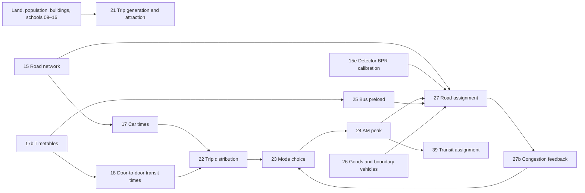

# TransitLab HK Methods Catalogue

> Compiled read-only by Codex from `docs/for-codex/task-43-methods-catalogue.md` (2026-09-28), checked by Claude with the same day's fix. Chinese version: [`methods-catalogue.md`](methods-catalogue.md). Line numbers refer to the 2026-09-28 code.

> Read-only snapshot of `F:\transitlab-hk`, checked on 2026-09-28. This describes the **current files**; it is not an instruction to rerun the pipeline. Line numbers refer to that snapshot. Fitted values come from `data/model/*.json` and `data/web/*-audit.json`. Motorised trips exclude journeys made entirely on foot or by bicycle (`pipeline/21_trip_generation.py:17-19`). HBW = home-based work; HBS = home-based school; HBO = other home-based; NHB = non-home-based; CBS/CBR/CBV = cross-boundary students/residents/visitors.

**Reading the calculations.** These equations use plain text and symbols, with no math renderer needed: Σ means “add all entries,” ÷ means “divide,” ^2 means “square,” and exp(−β × time) gives less weight to longer trips. Each card defines its symbols and units immediately after the calculation.

## One-page overview

- Stage 1 finds each traffic zone's trip productions and attractions; stage 2 connects origins to destinations; stage 3 selects available modes; stage 4 places AM peak vehicles and transit passengers on networks. The 27b→23→24→27 loop reconciles congestion and mode choice.
- Begin with `00_步骤分类.md`, then read A (main chain), B (input calculations), and C (retired fleet sandbox and quick browser demo). Lecture sources and page numbers are in `01_课程要点.md`.

# A. Four-stage main-chain method cards

## A15 Road network: the capacity and time skeleton

**Position.** TD roads, OSM lanes, zone centroids, and land grid → `road-links` and `road-connectors` → 17, 25, 27.

**Equations.**

> **Calculation:** Link capacity = look up road class, lane count and divided status in the capacity table.

Symbols/units: c_ℓ is directional design capacity in vehicles/hour; n_ℓ is directional lanes; class and divided status are categorical. In plain terms, look up TPDM Volume 2 Table 2.4.1.1 by class, then account for lanes. **Code:** `pipeline/15_road_network.py:100-108,225-234`. Expressway 1/2/3/4 lanes: 1500/3000/4700/6300 vehicles/hour; divided primary roads 1400 per lane; undivided primary 1000 for one lane or 1250 per lane otherwise; district distributors 850 for one lane or 975 per lane otherwise; local roads 400 per lane (`data/web/road-network-audit.json:report`).

> **Calculation:** Free-flow link time (min) = 60 × length (m) ÷ [1000 × speed (km/h)].  
> Zone connector time (min) = 60 × connector distance (m) ÷ (1000 × 25).

L_ℓ,d_zn are metres, posted u_ℓ is km/hour, t is minutes. Distance divided by speed gives free-flow time; a connector from a zone to a road node is slower, at 25 km/hour. **Code:** `pipeline/15_road_network.py:353-363`; `pipeline/17_car_skim.py:83-89`. Missing posted speed defaults to 50 km/hour (`pipeline/15_road_network.py:85`); connector speed is 25 (`pipeline/17_car_skim.py:48`).

> **Calculation:** Water-crossing distance = sum of sampled segment lengths flagged as sea/reservoir.  
> Accept only connectors with water-crossing distance ≤ 30 m.

L is connector length in metres, N is the number of samples, and water-crossing distance is estimated metres across sea/reservoir; the indicator is unitless. Roughly every 10 m along the straight connector is checked, and a candidate crossing more than 30 m of water is rejected. **Code:** `pipeline/15_road_network.py:494-513,556-569`; threshold `pipeline/15_road_network.py:150`. Audit: 867 candidates skipped and zero final water-crossing connectors (`data/web/road-network-audit.json:report`).

**Calibration.** No statistical fit; missing OSM lane counts use class defaults (`pipeline/15_road_network.py:98-99`). **Check.** 36,471 links; 452/455 zones connected. **Limitations.** Only 9.3% of links have an individually posted speed; TPDM design capacity still needs empirical checking; three island zones have no road connection.

## A15e BPR calibration: how volume slows a road

**Position.** Hourly flow/speed from 05 plus capacity from 15 → `bpr-parameters.json` for 27.

> **Calculation:** Observed time multiplier in bin b: y ≈ 1 + α × (volume/capacity)^β.  
> With β fixed, α = Σ[bin observations × x^β × (observed multiplier−1)] ÷ Σ[bin observations × x^(2β)].  
> RMSE = √[Σ(bin observations × prediction error²) ÷ total observations].

x=v/c and y=t/t_0=u_night/u_hour are unitless; v,c are vehicles/hour; n_b counts detector-hours in bin b; α,β are unitless. Group similarly loaded road observations, then fit their observed slowdown, weighting a group by sample count. **Code:** `pipeline/15e_bpr_calibration.py:65-83`. Current β=2 fixed and α=0.3776; bins are 0.1 wide, require 20 observations, and 01:00–04:00 is the night baseline (`pipeline/15e_bpr_calibration.py:40-42,70-79`; `data/model/bpr-parameters.json`).

**Calibration.** 20 weekdays, 680 detectors, 16,225 detector-hours; weighted least squares on bin means. Free fitting gives β≈1.3, but mid-link spot detectors miss junction queues and such a low exponent lets assignment overfill roads (`pipeline/15e_bpr_calibration.py:17-24`). α has a closed-form solution, so no iteration tolerance applies. **Check.** RMSE 0.0304 against 0.0841 for the former textbook 0.15/4 (`data/web/bpr-calibration-audit.json`). **Limitations.** 637/680 detectors are on expressways but one curve serves every class; urban junction delay may rise faster.

## A17 Car impedance matrix

**Position.** Network 15 and zone order 16 → free-flow OD time, distance, and path toll for 22, 23, 26.

> **Calculation:** Free-flow time from zone i to j = minimum, over feasible routes, of the sum of link free-flow times.  
> Intrazonal time = half the free-flow time to the nearest other zone.

i,j are traffic zones, p is a feasible path, and t is minutes. Each OD pair takes the least-time road path; an intrazonal trip approximates half the nearest external trip. **Code:** `pipeline/17_car_skim.py:97-118,121-128`. Connector speed is 25 km/hour; among 455×455 pairs, 2,718 cannot be driven because they touch the three roadless zones (`data/web/car-skim-audit.json`).

**Calibration.** None; deterministic shortest path. **Check.** Free-flow examples: Tuen Mun→Central 26 minutes and Sha Tin→Tsim Sha Tsui 12 (`car-skim-audit.json:report`). **Limitations.** Toll is recorded but does not choose this path; turn restrictions are not implemented at this stage; these are uncongested times (`pipeline/17_car_skim.py:12-22`).

## A18 Door-to-door transit impedance

**Position.** Merged GTFS 17b, OSM walking network, and zone centroids → transit/walking/cycling OD times for 22 and 23.

> **Calculation:** Door-to-door transit time = R5 schedule/path result including access walk, wait, onboard ride, transfer and egress walk (07:30–08:30 window).

t_ij^PT and its components are minutes. Think of walking to the stop, waiting, riding, transferring, then walking out. This describes the components of **R5's internal schedule/path calculation**, not a hand-coded sum in this repository. **Code:** `pipeline/18_transit_skim.py:11-17,302-308`. Current value is the median over the one-hour window starting 2026-09-22 07:30; walking/cycling speeds are 3.6/12 km/hour (`pipeline/18_transit_skim.py:83-90`).

> **Calculation:** Fallback walking connector (min) = 60 × 1.3 × straight-line distance (m) ÷ (1000 × 3.6).

d is an unroutable straight connector in metres and t is minutes. With a missing walking link, add 30% detour before dividing by walking speed. **Code:** `pipeline/18_transit_skim.py:218-246`; values `pipeline/18_transit_skim.py:89,94`.

**Calibration.** None; GTFS and R5 schedule routing. **Check.** Only four transit OD pairs are unreachable within three hours; no transit result exceeds direct walking (`data/web/transit-skim-audit.json`). **Limitations.** 93% of departures are sampled randomly from headways; rerouting the same OD may shift time about 1–2 minutes. No vehicle crowding or extra transfer penalty.

## A20 Survey behaviour parameters

**Position.** Extract trip rates, mean times, car access, value of time, and hourly profiles from TCS 2022 and appendices → `parameters-tcs2022.json` for 21–24 and 27b.

> **Calculation:** Trip rate for a purpose and district = purpose trips ÷ corresponding population.  
> Purpose share in hour h = that hour’s plotted area ÷ the sum over 24 hours.

Q is trips/day; N is people, workers, or students; r is trips per matching person/day; F is the plotted hourly area and s a unitless share. Divide purpose trips by their relevant population and normalise the 24 hourly bands in Figure 3.3. **Code:** `pipeline/20_behaviour_parameters.py:227-249,328-365`; use in `pipeline/21_trip_generation.py:226-239`. HBW/HBS/HBO/NHB source rates are 1.36/1.05/0.70/0.13; 08:00–09:00 is about 13.1% (`data/web/tcs-parameters-audit.json:report`).

**Calibration.** Table extraction and consistency checks, not behavioural fitting. **Check.** Table 3.3 purpose counts total 12,363,000 and Figure 3.3 covers 100% of the day. **Limitations.** The survey lacks an all-walking total and walking speed; some appendix PDF columns interleave, so the code checks pagewise number presence (`pipeline/20_behaviour_parameters.py:29-48`).

## A21 Stage 1: trip production and attraction

**Position.** 2026 population, jobs, students, floor area from 16; survey parameters from 20; boundary totals from 13 → trip ends in 470 internal/external zones for 22 and weighted building centroids.

**Equations.**

> **Calculation:** Zone trip productions = relevant 2026 population × (2022 surveyed trips ÷ 2022 relevant population) × definition adjustment.

P_ip is trips per weekday from zone i for purpose p; N is residents, workers, or students; Q is survey trips/day in district d; φ_p is unitless. Multiply the surveyed trips per relevant person by the zone's count. **Code:** `pipeline/21_trip_generation.py:226-240`. φ_HBW/HBS/HBO=1.0362/1.0912/0.9983 (`data/web/trip-generation-audit.json:production_rates_2022`).

> **Calculation:** Predicted amount = sum of each explanatory variable × its coefficient; choose nonnegative coefficients that minimise the sum of squared prediction errors.  
> R² = 1 − squared residual sum ÷ squared variation of observations around their mean.

y_d is district jobs or attraction trips/day; X_dk is floor area in m², places, or population; θ_k is jobs/trips per corresponding unit; R^2 is unitless. Each land use contributes a nonnegative amount; solve the coefficients that best explain observed districts. **Code:** `pipeline/21_trip_generation.py:261-275,291-305,327-335`. Jobs fit across 18 districts gives R^2=0.9353; office/retail/industrial/hotel coefficients are 0.045897/0.041316/0.010473/0.029595 jobs/m² and residents 0.200135 jobs/person (`trip-generation-audit.json:jobs`). HBS/HBO/NHB attraction R^2=0.9103/0.766/0.753 over 26 TCS districts (`:attractions.fits`).

> **Calculation:** Zone attractions = its 2026 relative weight × (survey district attraction total ÷ summed 2022 district weights) × (territory productions ÷ raw attractions).

A,P,Q are trips/day and w is a purpose-specific regression-derived weight (units depend on the purpose); the last ratio is unitless. Survey district attraction totals anchor the fit's within-district allocation; the territory total is then balanced to production. **Code:** `pipeline/21_trip_generation.py:347-364`. HBW/HBS/HBO/NHB factors 0.944/0.941/1.012/1.022 (`trip-generation-audit.json:attractions.balance_factors`).

**Calibration.** TCS 2022 Appendices A.1/A.2 give 26-district counts; Planning Department TPEDM 2021 gives 18-district jobs. SciPy `nnls` fits nonnegative land-use coefficients after column scaling. Its iteration details come from the library; the repository sets no stopping threshold. **Check.** 12,310,384 local motorised trips in 2026, 0.4% below the 12,363,000 survey count; another 905,720 cross-boundary trips (`trip-generation-audit.json:report`). **Limitations.** The original survey was conducted while border crossings were shut; distributing cross-boundary residents by population and visitors by retail/hotel is assumed. The +56% Yuen Long jobs change is a planning projection, not observation (`pipeline/21_trip_generation.py:43-50`).

## A22 Stage 2: trip distribution

**Position.** 21 trip ends and 18 transit OD times → purpose-specific OD trips for 23.

**Equations.**

> **Calculation:** OD trips = origin productions × destination attractions × row/column balancing factors × exp(−β × transit time) × harbour factor^crossing indicator × local factor^internal indicator.

T,O,D are trips/day; a_i,b_j are balancing multipliers; c_ij is transit minutes; β_p is minute⁻¹; H_ij indicates harbour crossing and I_ij a trip within the same major area; K,S are unitless. More origins and attractions create more trips; long times suppress trips; the harbour and local-area factors add Hong Kong geography. **Code:** `pipeline/22_trip_distribution.py:192-203,137-149`. β_HBW/HBS/HBO/NHB=0.04667/0.08108/0.08460/0.06946 minute⁻¹; K=0.6170; Sha Tin/Ma On Shan internal S=2.3418 (`data/web/trip-distribution-audit.json:purposes,harbour_factor_k,area_factors`).

> **Calculation:** Row balance = target productions ÷ current weighted row sum.  
> Column balance = target attractions ÷ current weighted column sum.  
> Seed weight = exp(−β × time) × harbour adjustment × local adjustment.

a,b are balancing multipliers; W is unitless; O,D are trips/day. Furness repeatedly scales rows and columns of an OD table to their required totals. **Code:** `pipeline/22_trip_distribution.py:137-149,201-203`. At most 500 iterations; stop when maximum relative row error is below 10^-4 (`pipeline/22_trip_distribution.py:83,137-148`). Current purpose errors are 6.5–9.9×10^-5 (`trip-distribution-audit.json:purposes`).

> **Calculation:** Model mean trip time = Σ(OD trips × OD time) ÷ Σ(OD trips).  
> Target time = self-reported survey mean × (45÷42) ÷ conversion factor r.  
> New local factor = old factor × (survey internal odds ÷ model internal odds); odds = internal share ÷ (1−share).

c,c^* are minutes; r is the unitless self-report/engine time ratio; q_a is the survey internal-trip share and q̂_a the model share; S_a is unitless. Match model mean time to survey after a common time conversion, then update each area's local odds. **Code:** `pipeline/22_trip_distribution.py:159-161,183-199,205-218,324-340`. r=1.2803; Hong Kong Island S=1 because its self-containment overlaps the harbour constraint (`pipeline/22_trip_distribution.py:94-98`).

**Calibration.** Per-purpose β uses geometric-midpoint bisection until bound ratio <1.002, targeting c_p^*. At each candidate r, twelve bisection steps fit K to TCS Table 3.4's 15.9% cross-harbour share. Golden-section search over r∈[1.0,1.6] stops at width <0.01, minimising percentage-point RMSE for four other Table 3.4 regional shares and Table 3.5's ten-area self-containment. Nine area factors then receive odds updates for up to 12 rounds, stopping at maximum gap <0.5 pp or improvement <0.1 pp (`pipeline/22_trip_distribution.py:205-256,290-340`). The audit retains ten r trial points and the final error; the **actual nine-area iteration count is unverified** (the handoff says five; `docs/handoff.md:7-10`). Final RMSE is 0.529 pp (`trip-distribution-audit.json:misfit_pts`). **Check.** Sha Tin/Ma On Shan internal share 31% versus survey 31%; cross-harbour 15.9% versus 15.9%. Within 30 minutes: 30% model versus 48% survey, with different transit-time versus all-mode-time definitions (`trip-distribution-audit.json:report`). **Limitations.** Area factors stand in for missing rail crowding; boundary OD uses HBO decay provisionally; one time conversion need not fit every purpose.

## A23 Stage 3: mode choice

**Position.** OD trips 22, car/transit impedance 17/18, 27b delay, TCS car ownership and VOT → PV, TAXI, PT, SPB trips for 24.

**Equations.**

> **Calculation:** Generalised cost (min) = travel time + monetary cost ÷ value of time.  
> Mode utility = mode constant − time sensitivity × generalised cost.  
> Mode probability = exp(its utility) ÷ sum of exp(utility) across feasible modes.

G,t are generalised minutes; F is HKD; VOT is HKD/minute; λ is minute⁻¹; ASC,V,P are unitless and M_g is a car/no-car group's feasible modes. Convert money to time; less time/cost raises probability; a person without car access cannot choose PV. **Code:** `pipeline/23_mode_choice.py:387-420`. Actual costs: PV = drive + five minutes of walking at each end + toll/VOT; TAXI = drive + 0.1713×(fare+toll)/VOT; PT = door-to-door + approximate fare/VOT; SPB = drive. Congested drive time is free flow plus a purpose weight times AM delay (`pipeline/23_mode_choice.py:387-395`; `data/web/mode-choice-audit.json:taxi_fare_weight`).

> **Calculation:** New mode constant = old constant + ln(target trips ÷ model trips).

ASC is unitless and N trips/day. If one mode attracts too few modelled trips, increase its constant by the log target/model ratio. **Code:** `pipeline/23_mode_choice.py:423-436`. Up to 200 rounds per purpose, stopping at max relative gap <10^-4; PT's constant stays zero (`pipeline/23_mode_choice.py:165,423-435`).

> **Calculation:** Choose time sensitivity λ to minimise RMSE between modelled and survey switching shares for added times of 15, 30 and 45 minutes.

e is extra minutes, s is a switching share, and λ is minute⁻¹. Fit sensitivity to three survey answers about whether adding 15/30/45 minutes changes mode. **Code:** `pipeline/23_mode_choice.py:449-467,509-521,545-568`. λ=0.0637366 per generalised minute; RMSE 7.2% (`data/web/mode-choice-audit.json:sensitivity_per_min,report`).

**Calibration.** TCS Table 4.2 gives public/subsidised/private-housing car-owning shares 5.5/12.1/25.1%; zone housing mix is scaled to 26-area Appendix A.4 shares. Car-owning households are 17.3%, or 21.2% of people after household-size adjustment (`pipeline/23_mode_choice.py:187-240`; audit report). VOT adjusts TCS Table E.6 for median household income HKD 28,300→30,000; a fare approximation is fitted to 8,750 MTR station pairs, about HKD 5.68+0.84d_straight (`pipeline/23_mode_choice.py:245-288`). Golden search fits λ to 0.002 precision; geometric bisection fits taxi fare weight until high/low <1.01, targeting census taxi vehicle-km share among PV+TAXI. Alternate them up to three rounds; changes <0.003 and <0.02 stop (`pipeline/23_mode_choice.py:484-558`). Target modal shares are from TCS Appendix A.3. Recent 12-month TD taxi average is 687,995 daily rides; after cross-boundary target, local target is 582,453 (`pipeline/23_mode_choice.py:365-385`; audit report). **Check.** Taxi vehicle-km share 25.39% against census 25.41%; largest modal-share gap <10^-4; reconstructed taxi daily total 686,877 against official 687,995, −0.2% (`mode-choice-audit.json`). **Limitations.** MTR distance fares proxy for bus/minibus; parking, fuel and waiting are partly absorbed by ASC. Table 5.2 switching also includes bus-to-rail, while this model aggregates PT.

## A24 Daily trips to AM peak

**Position.** 23 daily purpose/mode OD → 08:00–09:00 passenger and vehicle matrices for 27 and 39.

> **Calculation:** AM peak OD trips = purpose time share × [outbound share × daily i→j trips + return share × daily j→i trips].  
> AM vehicles = AM passenger trips ÷ occupancy.

T is trips/day, H trips/hour, f_p an hourly share, d_p the production-end departure share, o_m persons/vehicle, and V vehicles/hour. Slice daily OD into the peak, reverse the returning portion, then divide passengers by occupancy. **Code:** `pipeline/24_peak_hour.py:98-113,165-171,185-186`. f_HBW/HBS/HBO/NHB=21.2/11.9/6.4/8.0%; d=99/100/70/50%; o_PV/TAXI/SPB=1.31/0.98/11.42 (`data/web/am-peak-audit.json:report`).

> **Calculation:** Adjusted peak trips for a mode = survey-based peak trips × (census peak share ÷ survey peak share) for that mode.

H is trips/hour and f a unitless time-period share. The survey-wide peak would overproduce cars, so census vehicle-specific peak shares rescale cars and the balance moves to PT. **Code:** `pipeline/24_peak_hour.py:188-203`. PV/TAXI/SPB factors are about 0.61/0.66/0.83 (audit report). **Calibration.** Vehicle-type hourly shares come from traffic census 2024 core-station AADT and class composition, weighted by station flow; direct ratio calibration, not an optimiser. **Check.** 1.67 million AM motorised passenger trips; 128,949 passengers transfer to PT, giving 1.391 million PT. AM PV/TAXI/SPB vehicles are 101,800/45,000/8,500 (`data/web/am-peak-audit.json:report`). **Limitations.** HBO’s 70% production-end departure is an explicit assumption (`pipeline/24_peak_hour.py:85`); the mode-specific correction preserves the overall total by moving the difference to PT.

## A25 Bus preload

**Position.** 17b timetables and road paths → fixed bus/minibus vehicles per road link in the AM peak for 27.

> **Calculation:** Number of runs = departures from the first-run time at each headway within the window, floored at zero.  
> Bus preload on a link = sum of departures of all routes using it.

N_h counts trips, h is headway in minutes, t is minutes, and v_ℓ^bus is buses/hour. Count departures in the window and place each route's trips on its road path. **Code:** `pipeline/25_bus_preload.py:107-129,204-245`; fixed-time departures are counted directly (`pipeline/25_bus_preload.py:123-129`). **Calibration.** None: schedule service is input; route matching uses shortest road path. **Check.** 1,709 operating routes; 88,432 bus and 57,338 minibus stop events in 08:00–09:00. At 113 core stations, franchised-bus model/census ratio is 0.84 and 79% have GEH<5; green-minibus ratio against all minibuses is 0.76 (`data/web/bus-preload-audit.json:report`). **Limitations.** GTFS lacks road traces, so shortest paths connect stops; depot trips, residents’ buses, and red minibuses are missing (`pipeline/25_bus_preload.py:18-32`; `docs/handoff.md` top).

## A26 Goods and boundary vehicles

**Position.** 2011 Goods Vehicle Trip Characteristics Survey, 2026 licensed fleet/boundary flows, and 17 free-flow car times → daily and 08:00–09:00 goods-vehicle OD for 27.

> **Calculation:** Goods origins/destinations = sum of each land activity × its regional trip rate.  
> Goods OD = origin × destination × balancing factors × exp(−β × time) × harbour adjustment.

O,D,T are goods-vehicle trips/day; q is land-use units, r trip rates per unit, c minutes, β_g minute⁻¹, and K_g unitless. Generate freight ends from activity, then connect them by time-decaying, doubly constrained gravity. **Code:** `pipeline/26_goods_and_boundary_vehicles.py:394-424,433-436,351-361`. Freight β_van/lgv/heavy=0.131/0.139/0.152 minute⁻¹ and harbour factor 0.32 (`data/web/goods-audit.json:beta,harbour`).

> **Calculation:** Free-flow target time = self-reported time ÷ ρ.  
> Regional error = √[sum of 15 squared regional-share errors ÷ 15].  
> Light-goods combined error = √[(regional error÷0.01)² + (ln[model vehicle-km÷target vehicle-km]÷0.15)²].

c_g^*,t_g are minutes; ρ_g is the reported/free-flow time ratio; E_region is a fractional regional-share error; VKM is vehicle-km and E is unitless. Self-reported time must be adjusted before comparison with free-flow car skims; the light-goods objective balances regional splits and vehicle-km. **Code:** `pipeline/26_goods_and_boundary_vehicles.py:441-452,485-512`. Current ρ_light=2.73 and ρ_medium/heavy=3.43 (`data/web/goods-audit.json:rho,rho_heavy`). **Calibration.** Observations: GVTCS 2011 Table 4.3 has 15 regional OD shares, Appendix A.2 has ends, and Table E.4 gives light-goods annual mileage; TD supplies the 2026 licensed fleet. Thirty bisection rounds per class fit β to reported mean time divided by ρ; 14 bisection rounds fit harbour K to harbour share. Golden-section search fits heavy ρ to Table 4.3 until interval width <0.02; hold that fixed and combine regional shares with vehicle-km for light goods (`pipeline/26_goods_and_boundary_vehicles.py:441-452,473-536`). **Check.** Largest regional-share gap 2.2 pp; light-goods vehicle-km 4.91 million/day against a 5.40 million/day annual-mileage-derived target, ratio 0.91 (`goods-audit.json:report`). **Limitations.** 2011 behaviour is assumed to persist to 2026; annual mileage includes weekends and cross-boundary segments; roadless island zones create no goods trips.

## A27 Road assignment and audit

**Position.** Network/capacity 15, BPR 15e, passenger cars 24, bus preload 25, freight 26 → congested link times/flows for 27b and census comparison.

> **Calculation:** Congested link time = free-flow time × [1 + α × (flow/capacity)^β].  
> Per-class perceived cost (min) = link time + toll weight × toll (HKD) ÷ class value of time.

t,C are minutes, v,c vehicles/hour, F HKD, VOT HKD/minute, and ω,α,β unitless. A busier link takes longer; a toll is expressed as minutes of route-choice cost. **Code:** `pipeline/27_road_assignment.py:82-90,290-313`; `pipeline/15e_bpr_calibration.py:9,75-83`. Current α=0.3776,β=2,ω=0.20; VOT for PV/taxi/light/heavy goods = 1.26/0.87/2.74/4.06 HKD/min (`data/web/assignment-audit.json:bpr,toll_weight,values_of_time`). The docstring at line 30 still says former 0.15/4; execution reads the current JSON at lines 84–86.

> **Calculation:** Among OD-conserving network flows, minimise the sum of link travel-time integrals from zero to each link’s flow.  
> For BPR, a link integral = free-flow time × [flow + α × flow^(β+1) ÷ ((β+1) × capacity^β)].

v is vehicles/hour; the integral has vehicle·minutes/hour units; F is the flow set satisfying OD and network conservation. Under Wardrop equilibrium, no user can improve by changing route alone; the Beckmann integral expresses a standard minimum for separable time costs. **Code connection:** `pipeline/27_road_assignment.py:299-313` invokes AequilibraE BPR and `bfw`; the repository does not implement this integral or BFW update. Multiclass fixed toll cost is added at lines 300–302. The library's precise multiclass objective and relative-gap denominator are **unverified**. For β=2, the integral has a cubic flow term.

> **Calculation:** Adjusted capacity = original capacity × (1−heavy-vehicle reduction).  
> Heavy share ≤15%: 0 reduction; 15–20%: 7%; >20%: 10%.

h is the vehicle share of heavy goods plus buses; c,c' are vehicles/hour and r unitless. Heavy vehicles lower effective capacity. Solve once, adjust capacities, and solve again. **Code:** `pipeline/27_road_assignment.py:79-81,349-373`. Above 25% heavy-vehicle share, 10% reduction is an extrapolation outside TPDM Table 2.4.1.2; the second solve took 19 BFW iterations and reached relative gap 9.2×10^-4 (`assignment-audit.json:report`).

> **Calculation:** Tunnel-chain α = ordinary α × max[1, 6 min ÷ tunnel-chain free-flow time].  
> GEH = √[2 × (model count−census count)² ÷ (model count+census count)].

t^0_chain is minutes; M,C are model and census vehicles/hour; the rest are unitless. A short tunnel entry would hide queues under ordinary BPR, so each tunnel chain receives a six-minute delay floor through alpha scaling. GEH balances absolute and relative count error. **Code:** `pipeline/27_road_assignment.py:155-200,389-405`. `TUNNEL_QUEUE_MIN=6` minutes (`pipeline/27_road_assignment.py:88`; audit `:tunnel_queue_min`).

**Calibration.** Five vehicle classes in AequilibraE bi-conjugate Frank–Wolfe (BFW) user equilibrium; target relative gap 10^-3, at most 100 iterations (`pipeline/27_road_assignment.py:89-90,303-313`). Toll weight was scanned across 1.00/0.60/0.35/0.25/0.20/0.15/0.10, selecting 0.20; tunnel queue floor across 0/6/12/20 minutes, selecting six (`pipeline/27_road_assignment.py:87-108`; `docs/handoff.md` top). **Check.** Second assignment: 19 iterations and gap 9.2×10^-4; among 191 AM count directions, only 18.3% have GEH<5 against an 85% target; total flow ratio 0.960. For 17 corridor stations, 29.4% have GEH<5 against a 60% target (`assignment-audit.json`). **Limitations.** Local-road volume is only 0.22 times census; corridor target also fails. Junction queues lack an explicit queue model, so the six-minute tunnel floor is a calibration proxy.

## A27b Congestion-time feedback, with `feedback_loop.py`

**Position.** Recompute OD AM delay from assigned times 27 and feed it into mode choice 23. `feedback_loop.py` drives the repeats.

> **Calculation:** OD delay = mean of the nonnegative extra travel time in both directions.  
> Purpose time weight = Σ[hourly purpose share × (hourly flow÷08:00 flow)^β], with the same β as the assignment's BPR curve (currently 2).  
> Feedback car time = free-flow time + purpose weight × OD delay.

t,Δ are minutes; s is a purpose's hourly share; q is census hourly flow; w is unitless. Average both directions' additional AM travel time, then weight it by when that trip purpose actually occurs. **Code:** `pipeline/27b_congested_skim.py:58-69,112-115`; `pipeline/23_mode_choice.py:324-334,387-395`. w_HBW/HBS/HBO/NHB=0.804/0.801/0.743/0.811 (`data/web/congestion-feedback-audit.json:weights`). **Fixed 2026-09-28**: the first draft of this catalogue found the exponent hard-coded as 4 while the fitted BPR β is 2; 27b now reads β from `bpr-parameters.json`. The weights rose from 0.701/0.657/0.591/0.681 to the values above; the feedback settled in one round (0.7% gap) and corridor and MTR results barely moved (East Rail 1.36→1.37).

> **Calculation:** Delay used in round k = previous delay + (new assigned delay−previous delay) ÷ k.  
> Stability gap = Σ[vehicles ×   
> assigned delay−used delay  
> ] ÷ Σ[vehicles × assigned delay].

k is the round, V AM PV+taxi vehicle trips, g unitless. Each round uses 1/k of the new result to damp oscillation; a vehicle-weighted disagreement below 5% stops the loop. **Code:** `pipeline/27b_congested_skim.py:126-147`; driver `pipeline/feedback_loop.py:42-54`.

**Calibration.** Fixed-point feedback, not direct fitting to observations. Round order: 27b→23→24→27→27b `--check`, at most five rounds; stop at g<0.05. Current run settled after one round, g=0.0325; assigned delay 1.83 versus used 1.82 min/vehicle trip (`congestion-feedback-audit.json:history,last_disagreement,report`). **Check.** Corridor GEH<5 is still 29.4%, as in 27. **Limitations.** Only mean car delay returns, not rail crowding; the hourly fourth power differs from the new BPR square.

## A39 Optimal-strategy transit assignment

**Position.** AM transit OD and GTFS → line/segment passenger flows for comparison with Legislative Council MTR busiest-segment figures.

> **Calculation:** Run count = number of departures whose first-run time + k×headway falls in 07:30–09:30.  
> Bus onboard time = GTFS onboard time × 1.5.

h_r is seconds/departure, n_r the number of departures, and t minutes. Expand a headway template into actual peak departures; multiply bus/minibus onboard time by 1.5 for peak road congestion and optimistic timetables. **Code:** `pipeline/39_transit_assignment.py:112-127,248-255`; factor `pipeline/39_transit_assignment.py:53-54`. MTR headways are overwritten from official values, e.g. East Rail trunk 209 seconds and Island Line 114 seconds (`pipeline/39_transit_assignment.py:47-51,80-87`).

> **Calculation:** Among attractive transit lines, first-arrival probability is proportional to frequency; frequency is inversely proportional to headway.

f_r is departures/hour, h_r seconds/departure, and P unitless. At a stop with several attractive lines, board whichever arrives first; more frequent service is more likely to arrive first. **Code connection:** `pipeline/39_transit_assignment.py:11-12,301-307` invokes AequilibraE `optimal-strategies` with a `freq` field. The library's **exact waiting-time formula is unverified**; the repository only supplies frequency, so h/2 cannot be asserted as its actual formula.

**Calibration.** Bus time factors ×1.0/1.3/1.6/2.0 were scanned against seven busy MTR segments, yielding aggregate deviations 0.54/0.25/0.22/0.34; implemented factor is ×1.5. The interpolation rule from scan points to ×1.5 is **unverified** (`pipeline/39_transit_assignment.py:53-54`). MTR headways are coded source values rather than fitted. The library computes strategies; the project sets no convergence tolerance. **Check.** 1.3910 million PT trips, 1.3682 million (98.4%) on the network; East Rail Tai Wai→Kowloon Tong 60,779 versus 44,600 from Legislative Council, ratio 1.363 (`data/web/transit-assignment-audit.json:report,mtr_check`). **Limitations.** No carriage crowding feedback; East Rail is near capacity; some Legislative Council comparisons predate the 2026 model year.

# B. Method cards for input calculations

## B09 Building floor area

**Position.** Raw building footprint, height, and published floor counts → building GFA → 10, 14, 21. **Equation.**

> **Calculation:** Building gross floor area = footprint × floors.  
> When floors are missing: floors ≈ building height ÷ typical floor height in its band, rounded.

GFA,A are m², H, h metres and n floors. Estimate floor height from buildings with published counts, then infer missing counts from height. **Code:** `pipeline/09_building_stock.py:118-154,166-184`. Plausible floor heights are 2–8 m; a height band with fewer than 50 buildings falls back to 3.3 m/floor; maximum 120 floors (`pipeline/09_building_stock.py:52-61`). **Calibration.** Use footprint-size bands and median floor height among buildings with consistent height and published floor count; below 15 m, use median floors by footprint band and integer height, requiring 50 per cell. No optimiser iteration. **Check.** About 25% of buildings have published floor counts (`data/web/zones-attraction-audit.json:report`). **Limitations.** Footprint×floors is approximate gross floor area, not measured building GFA.

## B10 Floor area by zone and use

**Position.** Building GFA 09, Buildings Department uses and RVD district floor area → zone office/retail/residential GFA → 21. **Equation.**

> **Calculation:** Office share in unclassified commercial buildings = official office internal floor area ÷ (official office + retail internal floor area).  
> Zone-use GFA = sum of GFA of buildings of that use inside the zone.

IFA,GFA are m² and s unitless. Split unclassified commercial/office buildings by the official district office/retail ratio, then aggregate buildings to zones. **Code:** `pipeline/10_zone_attraction.py:169-184,257-263`. **Calibration.** Use 18-district RVD ratios as targets, adding whole buildings in descending area until each target; neither least squares nor iterative tolerance. **Check.** Median model gross area/RVD internal floor area: office 1.39, retail 1.13, industry 1.63; all 455 zones have buildings (`data/web/zones-attraction-audit.json:report`). **Limitations.** 33.8% of GFA has unknown use; gross and internal floor area have different definitions.

## B11 School places by zone

**Position.** Education Bureau school points and district enrolment → zone places → 16 and 21. **Equation.**

> **Calculation:** Allocated places per school = district-level enrolment ÷ district-level school count.

places and students count people; N counts schools. Equal-split district enrolment among schools of the same level, then locate each school in a zone. **Code:** `pipeline/11_zone_schools.py:174-202`. **Calibration.** No parameter search; allocation conserves published district totals. **Check.** Primary 317,233, secondary 347,820 and kindergarten 115,300 are all zoned; 385/455 zones contain schools (`data/web/zones-schools-audit.json:report`). **Limitations.** Actual school enrolments are not published individually; equal within-district shares are estimates.

## B12 Universities and hospitals

**Position.** Institution/hospital points and floor area → zone tertiary places and hospital GFA for 16/21. **Equation.**

> **Calculation:** Institution weight in a zone = its named-building GFA share + its campus-point share.  
> Zone places = official student total × zone weight ÷ total weight.

GFA is m², N campus points, w unitless, and places students. Combine two independent location signals, building-name floor area and campus points, then allocate the official student total. **Code:** `pipeline/12_zone_institutions.py:174-192`. **Calibration.** Official tertiary total is fixed, not regressed. **Check.** 354,698 allocated versus official 354,700, a two-person rounding difference; hospital area about 5 million m² or 166 m²/bed (`data/web/zones-institutions-audit.json:report`). **Limitations.** Leased commercial campus floor area is hard to separate; both signals are weights, not direct capacities.

## B14 Splitting traffic zones

**Position.** 211 census zones, housing floor area, rail stations → 455 model traffic zones for the main chain. **Equation.**

> **Calculation:** Child-zone population/households = parent total × child residential GFA ÷ sum of residential GFA across its children (then largest remainders for integers).

X is census people/households, and GFA housing m². Allocate parent counts to children by residential area, then use largest remainders to preserve integer totals. **Code:** `pipeline/14_split_zones.py:116-126,187-205`. **Calibration.** Rail stations seed floor-area-weighted k-means; target 18,000 residents/zone and seed 20260916 (`pipeline/14_split_zones.py:51-60,152-176`); this is spatial partitioning rather than survey fitting. **Check.** All 23 census count fields conserve totals; maximum zone population 47,847 and residential GFA about 76 m²/household (`data/web/zones-split-audit.json:report`). **Limitations.** Within-parent population placement is estimated; 19 boundary fragments arise from the split.

## B15c Census counts to links

**Position.** Census stations 07 and roads 15 → matching link/direction sets for 27's audit. **Equation.**

> **Calculation:** Model count for a station direction = sum of same-direction flows on links crossing that station’s count line.

M,v are vehicles/hour. A station may cut several parallel lanes, so sum all modelled links for the matching direction. **Code:** `pipeline/15c_census_links.py:22-29,113-134`; `pipeline/27_road_assignment.py:393-401`. **Calibration.** None; rank road name, distance, direction and 40 m cross-section, falling back to nearest 30 m when names fail (`pipeline/15c_census_links.py:52-57,137-170`). **Check.** 355 of 356 directions across 191 stations matched; 50 directions contain parallel links; one unmatched (`data/web/census-links-audit.json:report`). **Limitations.** Co-located elevated and ground roads can still mis-match; the unmatched eastbound station remains flagged.

## B15d Hourly road-speed profiles

**Position.** Detector speeds 05 and network 15 → per-direction per-hour speeds, used by the sandbox and supply checks. **Equation.**

> **Calculation:** Speed correction for class, posted speed and hour = median detector observed-speed÷posted-speed ratio.  
> Uncovered link speed = its posted speed × correction.

u is km/hour and r unitless. Use observed detector speed where present; otherwise carry the same road-class/speed/hour median ratio to uncovered links. **Code:** `pipeline/15d_speed_profiles.py:167-182,198-220`. **Calibration.** Of 24 days, use 20 weekdays and require at least five days for a detector-hour median; a class/speed/hour cell needs at least three detectors, otherwise borrow the wider class median (`pipeline/15d_speed_profiles.py:106-125,176-182`). No regression. **Check.** Detectors cover 7.1% of road length; 1,144,632 output records and territory AM median 50 km/hour (`data/web/road-speeds-audit.json:report`). **Limitations.** Spot speed misses junction delay and may be optimistic for urban 50 km/hour roads.

## B16 Land use and population in 2026

**Position.** Zone split 14, buildings/schools/institutions and planning projections → 2026 zone population, age, jobs and floor area for 21/17. **Equation.**

> **Calculation:** New zone population for an age group = projected zone population × (CSD territory age-group total ÷ summed projected zone population).

N is people in age band a. Keep the Planning Department's spatial distribution but scale each age band to CSD's actual 2026 territory total. **Code:** `pipeline/16_landuse_2026.py:186-200`; integer largest-remainder allocation `pipeline/16_landuse_2026.py:203-213`. **Calibration.** One proportional scaling pass to official age totals; parent-to-child allocation uses housing floor area. **Check.** 7,517,309 land residents versus 7,517,310 CSD, difference one; age 65+ 1,833,860 versus 1,833,859 (`data/web/landuse-2026-audit.json:report`). **Limitations.** Scaling does not correct occupancy in individual buildings.

## B36 Land-use grid

**Position.** Planning Department LUHK 2024 10 m grid → hectares by use and traffic zone; water grid assists 15/39. **Equation.**

> **Calculation:** Zone land-use area (ha) = count of 10 m grid cells × 100 m² ÷ 10,000.

A is hectares and N cells. Each cell is 100 m², so count and convert to hectares. **Code:** `pipeline/36_land_utilization.py:209-220`. **Calibration.** Raster shade-to-class mapping checked by cached samples; public/private housing separated by nearby residential buildings of three or more storeys, not regression (`pipeline/36_land_utilization.py:116-170`). **Check.** 1119.9 km² land against official 1119; largest difference among 25 read categories 0.65 km² (`data/web/land-utilization-audit.json:report`). **Limitations.** 1.5% of housing cells lack a building within 200 m and borrow a farther class; 13.5 km² land is outside the 455 zones.

## B37 Statutory zoning capacity

**Position.** Town Planning Board maps and explanatory notes → zonal use areas and buildable floor area for land scenarios. **Equation.**

> **Calculation:** Buildable zone GFA = sum, over intersecting planning polygons, of overlap area × allowed plot ratio.

A,GFA are m² and PR unitless plot ratio. Intersect each planning polygon with a traffic zone; multiply its overlap by permitted plot ratio. **Code:** `pipeline/37_statutory_zoning.py:264-266,290-301`. **Calibration.** Extract the first plot-ratio number after the note label; use planning-standard defaults where absent, not statistical fitting (`pipeline/37_statutory_zoning.py:160-205,224-260`). **Check.** 151 outline zoning plans plus two development permission area plans; 11,958 zones cover 617 km². Defaults cover 35% of private buildable-floor-area zones; 323 million m² residential capacity versus 204 million existing, ratio 1.59 (`data/web/zoning-audit.json:report`). **Limitations.** Defaults and missing “Other Specified Uses” notes can bias capacity; permissible capacity is not built stock.

## B38 Property prices and rents

**Position.** RVD district rateable value and broad-region prices/rents → 18-district property estimates inherited by traffic zones. **Equation.**

> **Calculation:** District property price = region price × (district rateable value per unit ÷ region rateable value per unit).  
> Annual gross yield = 12 × monthly rent per m² ÷ price per m².

P is HKD/saleable m²; RV HKD/unit, N units, Rent HKD/m²/month, Y annual gross yield. Transfer broad-region price according to each district's per-unit rateable-value ratio; annualise rent to yield. **Code:** `pipeline/38_property_values.py:80-112`. **Calibration.** Ratio transfer with no iteration. **Check.** Unit-weighted A/B-class estimates aggregate to official region prices; district yield 3.3–4.0% (`data/web/property-values-audit.json:report`). **Limitations.** All traffic zones in one district inherit the same price, so station proximity premium is absent.

## B-diagnose_corridors Corridor discrepancy diagnosis

**Position.** Read 27 assignment and census without modifying either → vehicle, station, corridor error report. **Equation.**

> **Calculation:** Corridor mismatch = Σ over stations   
> model count − census count × (model corridor total÷census corridor total)  
>  ÷ census corridor total.

M,C are vehicles/hour and I unitless. Align a corridor's model and census total, then measure how flows differ among its stations. **Code:** `pipeline/diagnose_corridors.py:124-133`; GEH as in 27, `pipeline/diagnose_corridors.py:83-85`. **Calibration.** None; diagnosis only. **Check.** All-network and corridor GEH rates should agree with `assignment-audit.json` within two percentage points (`pipeline/diagnose_corridors.py:180-183`). **Limitations.** An error report alone does not identify whether demand or supply caused a specific difference.

# Additional upstream and display calculations

These entries are outside the requested A/B list but contain numerical calculations. Other upstream steps mainly download, transform, or style data; see `00_步骤分类.md`.

### 05 Hourly detector observations
**Position.** Raw 30-second snapshots → 15e and 15d. **Equation.** q_h=120 n_30s,h; q_h is vehicles/hour and n vehicles/30 seconds. Average the two half-minute records in a snapshot before multiplying by 120. **Code:** `pipeline/05_traffic_detectors.py:67-90,201-214`. **Calibration.** None. **Check.** The former sum-then-×120 doubled flow; current code corrects it (`docs/handoff.md` 9/26). **Limitations.** Strategic/major roads with detectors only, and hourly samples are noisy.

### 07 Annual traffic census parsing
**Position.** Official station records → observations for 15c, 23–25 and 27. **Equation.** Q_s,h=AADT_s,weekday p_s,h/100; Q vehicles/hour, AADT vehicles/day, p percent. Apply the hourly share to the daily average. **Code:** `pipeline/07_annual_traffic_census.py:282-295`. **Calibration.** None; OCC class/occupancy weighted by station AADT (`pipeline/07_annual_traffic_census.py:185-214`). **Check.** Code reproduces the source table's two-direction peak flow (line 295). **Limitations.** Stations do not span the whole network; hourly shape comes from the survey year.

### 08 Census-zone base map
**Position.** 211 census zones from 2021 → split 14. **Equation.** density_z=population_z/area_z, people/km²; projected polygon area in m² divided by 10^6. **Code:** `pipeline/08_build_zones.py:106-108`. **Calibration.** None. **Check.** Original census attributes retained. **Limitations.** The 2021 geometry is not exact 2026 residential occupancy.

### 13 Representative weekday boundary flows
**Position.** Immigration Department daily flows and schoolchildren → external zones for 21. **Equation.** C_p,d=Σ_t∈ last12wk,weekdayC_p,d,t/N_weekday, persons/weekday. Average the last 12 weeks' weekdays to suppress single-day noise. **Code:** `pipeline/13_cross_boundary.py:47,99-122`. **Calibration.** None. **Check.** Representative two-way total 905,552 crossings; 16,656 student travellers, 16,655 located (`data/web/cross-boundary-audit.json:report`). **Limitations.** Checkpoint coordinates are entered manually and linked to nearest zones.

### 15b Detector road corridors
**Position.** Detector directions and 15 links → long lines for live map colouring. **Two calculations.** ① Position fraction = (current position−previous detector position) ÷ (next detector position−previous detector position); positions are along-road metres and the fraction is unitless (`pipeline/15b_detector_corridors.py:320-335`). ② Congestion here = previous detector congestion + (next detector congestion−previous detector congestion) × position fraction; then map that congestion to a colour. If neither detector has a reading, use grey; if only one does, use that reading (`frontend/src/map/liveTraffic.ts:123-136`). For 20% and 80% congestion at the endpoints, a point one-quarter along has interpolated congestion of 35%. **Nature.** This is distance-based linear interpolation, not an empirically fitted function; the 1.35 detour ratio is a geometric filter (`pipeline/15b_detector_corridors.py:62-65`). **Check.** `data/web/traffic/detector-corridors.json` stores position fractions. **Limitations.** The 35% is an estimate between sensors, not a measurement at that point.

### 17b Merging transit feeds
**Position.** Official bus/minibus/ferry GTFS plus community rail/light rail → 18/25/39. **Equation.** t_k=t_L+(w_k-w_L)(t_R-t_L)/(w_R-w_L); t seconds and w accumulated road free-flow time plus 0.4 minutes per stop. Interpolate missing intermediate stop times according to road travel-time share. **Code:** `pipeline/17b_transit_feed.py:19-25,134-213`; dwell value `pipeline/17b_transit_feed.py:56`. **Calibration.** None; published end times fixed. **Check.** Route 960 exposed straight-line interpolation error (`pipeline/17b_transit_feed.py:255-273`). **Limitations.** Community MTR headway bias is corrected for 39's peak but remains in 18's input (`docs/handoff.md` 9/25).

### 19 Web zone indicators
**Position.** 16/21 metrics and zone names → web output. **Equation.** growth_z=100(P_z^2026/P_z^2021-1) (%) and trips^out_z=Σ_pP_zp trips/day. These simply display growth and outbound trips. **Code:** `pipeline/19_web_zones.py:196-217`. **Calibration.** None. **Check.** Web population 7,517,309 and daily arrivals 12,310,398 match model endpoints (`data/web/zones-2026-audit.json:report`). **Limitations.** Display layer only; it does not change model outputs.

# C. Retired fleet sandbox and browser quick model

These are **summaries**, as authorised for priority C. Steps 28–35 remain in the repository but further fleet-sandbox work has stopped in favour of drawing new lines (`docs/handoff.md` 9/25). They do not calibrate the four-stage main chain.

| Step | Calculation/calibration and code | Check and limitation |
|---|---|---|
| 28 `taxi_requests.py` | Redistribute daily taxi OD over hours using TCS hourly shares and census taxi-flow shape, then sample individual requests with a Poisson process; `pipeline/28_taxi_requests.py:1-35`. | Times and locations are synthetic; current request total is in `data/web/taxi-requests-audit.json`. |
| 29 `fleet_supply.py` | Occupied vehicle-minutes sum over requests; divide by candidate utilisation to get a fleet lower bound; `pipeline/29_fleet_supply.py:1-38`. | Utilisation is missing as an observation; the coded range is a scenario, not measured. |
| 30 `td_digest_series.py` | Parse TD monthly patronage and licence time series; no behavioural fitting; `pipeline/30_td_digest_series.py:1-27`. | Column changes fail visibly rather than silently omitting data. |
| 31 `fleet_simulator.py` and `fleet_sim.py` | Minute-by-minute oldest-waiting-first, nearest-idle-vehicle dispatch; scale empty and occupied time by road speed; `pipeline/31_fleet_simulator.py:21-35`, `pipeline/fleet_sim.py:20-31`. | No rebalancing; within-zone pickup distance is zero; outputs are scenarios. |
| 32 `deployment_scenario.py` | Let autonomous vehicles accept calls only in nominated zones while ordinary taxis dispatch jointly; `pipeline/32_deployment_scenario.py:1-21`. | Inherits 31's no-break/no-charging and fixed-demand limitations. |
| 33 `deployment_web.py` | Arrange 32/34 scenario tables into browser JSON; `pipeline/33_deployment_web.py:1-27`. | Display computation only; no further fitting. |
| 34 `scenarios.py` | Scan night operating windows and autonomous-vehicle additions with matching taxi-licence withdrawals; `pipeline/34_scenarios.py:1-29`. | Policy scenario, not a market forecast. |
| 35 `duty_and_charging.py` | Add staggered driver duties and use-linked charging separately to 31's dispatch to recalculate minimum fleet; `pipeline/35_duty_and_charging.py:1-34`. | No charger queues or optimised rosters. |
| `game-demo/engine.js` | Bridge quick model reads packaged OD times, vehicle flows and rough cost; 1,800 vehicles/hour/lane and 80 km/hour are demo parameters; `game-demo/engine.js:1-23`. | Does not rerun full four stages; cost is approximate. |
| `game-demo/sim.js` | New rail line changes transit times, then incremental distribution/logit, fewer cars on roads, and population elasticity 0.5 on accessibility, with successive averages until two-round difference <0.5% (max 12); `game-demo/sim.js:1-34`. | Elasticity 0.5 is explicitly estimated, not empirically calibrated; browser data were frozen before the 9/26 main-chain update (`docs/handoff.md`). |

# Alignment with CA5236

Page numbers count PDF pages from the cover. The Week 4 outline says *Policy Intervention and Economic Development*, while the supplied `CA5236_Lec4.pdf` is actually *Decision Making Modelling*; this table follows the supplied lecture. `01_课程要点.md` gives the page-by-page notes. “Original form” means the equation's structure, never that illustrative lecture coefficients are Hong Kong estimates.

| Course topic (week / lecture page) | Lecture equation or concept | Model correspondence (step, equation) | Original or adapted? | What changes and why |
|---|---|---|---|---|
| Lecture 1 pp.18–19; Lecture 3 pp.11–15 | Derived demand and land–transport feedback | 21 generation, 17/18 impedance, 27b feedback | Conceptual/partial | Congestion time feeds back; no long-run joint land development and migration equilibrium. |
| Lecture 1 pp.22–23 | Mobility vs accessibility; four components | 17/18 OD times | Adapted | These compute only transport-time accessibility, not every land, time, and personal component. |
| Lecture 1 pp.24–27 | Five Ds and induced demand | 09–16 spatial inputs; demo population elasticity | Partial | Not all Ds are fitted; demo elasticity is not a lecture-derived empirical parameter. |
| Lecture 1 pp.29–30 | Land value capture and TOD | 37 capacity, 38 values | Conceptual | Present outputs are baseline inputs, not a causal policy appraisal. |
| Lecture 1 pp.33–36; Lecture 3 pp.34,54 | Four stages and sequential limits | 21→22→23→27, with 27b feedback | Original framework plus loop | 17/18 supply impedance and 24–26 convert daily person trips to peak vehicles; 27b relaxes strict one-way flow. |
| Lecture 2 pp.28–34 | Monocentric model and y=z+p(x)q+T(x) | 17/18 travel time, 38 price | Conceptual only | Polycentric Hong Kong; no solved housing-choice/land-bid equilibrium. |
| Lecture 2 pp.56,62 | Fast and slow timescales | 16's 2026 slice and demo scenario | Conceptual | Land changes more slowly than traffic; demo has no actual development lag. |
| Lecture 3 p.5 | Density D(x) = D₀ × exp(−β × x) | 16/36 density data | Not used | A single CBD distance is ill suited to a polycentric region; retain zones and grid. |
| Lecture 3 pp.9–10 | Income elasticity of housing demand | 38 price and demo accessibility elasticity | Different measure | Demo 0.5 relates population to accessibility, not housing demand to income. |
| Lecture 3 pp.35–38 | Total control and group rate × people | 20 rates, 21 P=Nr | Original form | Finer purpose/groups and zonal checks against survey totals. |
| Lecture 3 pp.39–40 | Land-use area × unit production/attraction rate | 21 attraction with floor area/jobs/places | Adapted | Purpose-specific inputs; regression sets weights, official district totals anchor levels. |
| Lecture 3 p.41 | Linear generation/attraction regression | 21 attraction NNLS | Adapted | Nonnegative coefficients avoid negative attractions; production mainly uses trip rates. |
| Lecture 3 pp.42–44 | OD gravity “push × pull × impedance” | 22 T_ij=a_iO_ib_jD_jf(c) | Adapted | Doubly constrained a,b preserve both end totals; add harbour and intra-area factors. |
| Lecture 3 p.45 | Power, exponential, combined impedance | 22 f(c) = exp(−β × c) | Original exponential form | Purpose-specific β fitted to Hong Kong mean times; lecture's numbers are illustrative. |
| Lecture 3 p.46 | Log-transform then OLS for gravity | 22 bisection for β, Furness | Adapted | Directly match mean travel time and both end totals instead of one OLS. |
| Lecture 3 pp.47–50 | OD trip interchange; service/time/fare; S curve | 23 generalised cost + MNL | Concrete specification | Lecture 4 pp.11–12 gives the logit equation; 23 adds car access choice sets. |
| Lecture 3 pp.51–53 | Incremental assignment and level of service | 27 equilibrium assignment, 15e BPR | Adapted | Repeated route adjustment reaches a relative gap and flows affect travel time. |
| Lecture 4 pp.7,10 | U=V+ε, utility time/fare terms | 23 V=ASC-λ(t+F/VOT) | Adapted | Express money as minutes; comfort and reliability are not identified separately. |
| Lecture 4 pp.11–12 | Binary and multinomial logit | 23 P_m=e^V_m/Σ e^V_k | Original form | Estimate separately by purpose and car access; unavailable alternatives have probability zero. |
| Lecture 4 pp.13–14 | Choice set, ASC, personal interactions | 23 car/no-car and purpose ASC | Adapted | Grouping replaces person-level interactions; constants match aggregate TCS shares. |
| Lecture 4 pp.15–17 | Maximum likelihood and utility→probability | 23 sensitivity/taxi-weight searches | Adapted | Calibrated to aggregate survey moments and vehicle-km shares, not full individual-record MLE. |
| Lecture 4 p.18 | VOT=β_t/β_c | 23 fare/VOT | Same principle, different values | Lecture's HKD 2/min is illustrative; project uses local TCS with income adjustment. |
| Lecture 4 pp.19–20 | Fare change → utility → probabilities → demand | 23 fare/toll inputs | Original application | Recompute mode shares after changing generalised cost. |
| Lecture 4 pp.21–22 | IIA and nested logit | 23 ordinary MNL | Nesting not implemented | Similar transit modes can share unobservables; red/blue bus IIA issue persists. |
| Lecture 4 pp.24–29,31–35 | Time-use survey, tours, ABM | 20 hourly profile, 21–27 aggregate stages | Partial | No person-day schedules or linked tour decisions. |
| Week 7 will cover Traffic Impact Analysis (outline only) | Station/corridor impact theme | 15c/27 census checks | Topic match | No Week 7 PDF; GEH cannot be attributed to its slides. |
| Week 9 will cover Transportation Network Modelling (outline only) | Network modelling theme | 15/17/27/39 | Topic match | No Week 9 PDF; cannot claim BPR, BFW or transit strategies were presented. |
| Week 10 will cover Transit-Oriented Development (outline only) | TOD theme | 37/38 and demo new rail line | Topic match | Demo does not estimate long-term land development. |
| Outside supplied lectures (standard textbook material) | BPR, Wardrop–Beckmann, BFW, Furness, MSA, GEH | 15e, 22, 27, 27b | Project implementation | See Ortúzar & Willumsen, *Modelling Transport*, and Sheffi, *Urban Transportation Networks*; no invented lecture page or textbook chapter. |
| Outside supplied lectures (standard textbook material) | Spiess–Florian optimal-strategy transit assignment | 39 | Project implementation | See the original Spiess–Florian method and Ortúzar & Willumsen, *Modelling Transport*; not in Lectures 1–4. |

# Three reproducible small examples

These use **actual project coefficients**. OD totals and times are explicitly illustrative, not actual Hong Kong zones. `算例复算.py` reproduces the numbers without reading or modifying project data.

## Example 1: three-zone doubly constrained gravity, two Furness rounds

Let HBW production O=(120,80,100) and attraction D=(90,110,100) trips/day. Transit minutes are row 1 (10, 20, 30), row 2 (20, 10, 20), row 3 (30, 20, 10). Trips between zones 1 and 3 cross the harbour. Use actual A22 HBW β=0.04667/minute and K=0.617 (`data/web/trip-distribution-audit.json:purposes,harbour_factor_k`); omit local-area S for this example. With W_ij = exp(−β × c_ij) × K^H_ij (`pipeline/22_trip_distribution.py:137-149,192-203`):

> **Calculation:** Illustrative three-zone impedance matrix: [[0.627068, 0.393215, 0.152135], [0.393215, 0.627068, 0.393215], [0.152135, 0.393215, 0.627068]].

Start at b_j=1 and update a_i=O_i/Σ_jW_ijb_j, b_j=D_j/Σ_i a_iW_ij (`pipeline/22_trip_distribution.py:137-149`). **Round 1:** a=(102.352591,56.597212,85.293826), b=(0.905313,1.006629,1.095155); row sums (115.671,80.246,104.083) and exact column sums (90,110,100). **Round 2:** a=(106.182863,56.423932,81.947889), b=(0.888996,1.005876,1.114482):

> **Calculation:** Furness round-two OD matrix (trips): [[59.193, 41.998, 18.004], [19.724, 35.590, 24.727], [11.083, 32.412, 57.270]].

Rows (119.194,80.040,100.766) are closer to target, while columns remain (90,110,100). More rounds are needed for the code's 10^-4 relative row tolerance.

## Example 2: two-mode logit with a five-minute car advantage

Restrict the illustration to **car-owning HBW** travellers choosing PV or PT. Set the monetary part of their two generalised costs equal and omit other modes. Actual coefficients: ASC_PV=-0.7444, ASC_PT=0, and λ=0.0637366232/minute (`data/web/mode-choice-audit.json:constants.HBW,sensitivity_per_min`); actual mode costs/sets are in `pipeline/23_mode_choice.py:387-420`. With Δ t=t_PT-t_PV,

> **Calculation:** Car probability = 1 ÷ [1 + exp(−[car constant + time sensitivity × (transit time−car time)])].

(`pipeline/23_mode_choice.py:398-410`). Equal times give P_PV=32.20%. If driving is five minutes faster, Δ t=5 and the utility difference is -0.7444+0.0637366×5=-0.42572, giving P_PV=39.51%. Five minutes slower gives 25.67%. This **restricted two-mode illustration** is not the full PV share, which also depends on taxis, SPB, fares, tolls, and purpose.

## Example 3: current versus former BPR curve

For the same free-flow time t_0, compare current fitted t/t_0=1+0.3776(v/c)^2 (`pipeline/15e_bpr_calibration.py:65-83`; `data/model/bpr-parameters.json`) with former textbook 1+0.15(v/c)^4 (`pipeline/15e_bpr_calibration.py:14-25`).

| v/c | Current t/t_0 | Former t/t_0 | Current time if t_0=10 min |
|---:|---:|---:|---:|
| 0.5 | 1.094400 | 1.009375 | 10.944 min |
| 1.0 | 1.377600 | 1.150000 | 13.776 min |
| 1.5 | 1.849600 | 1.759375 | 18.496 min |

The current curve is slower at these three ratios; this does not imply that ordering for every v/c. Its parameters come from weighted detector calibration (`data/web/bpr-calibration-audit.json:report`).

# Glossary

| Chinese | English | Plain-language meaning |
|---|---|---|
| 交通分区 | traffic zone | A small region used to count activity and build an OD table; not necessarily an administrative district. |
| 出行产生 / 吸引 | trip generation / attraction | Trips leaving/arriving in each zone. |
| 出行分布 | trip distribution | Which origin is linked to which destination. |
| 方式选择 | mode choice | How trips divide among available modes. |
| 分配 | assignment | Which roads or transit lines carry OD passengers/vehicles. |
| 拟合 / 校准 | calibration | Tune parameters so specified model statistics resemble observations. |
| 广义费用 | generalised cost | Put time, fare, toll and other burdens on one comparable scale. |
| 时间价值 | value of time | Money a traveller is willing to pay to save one unit of time; check units. |
| 交通阻抗 | travel impedance | A cost function that discourages long or expensive trips. |
| 双约束 / Furness | doubly constrained / Furness | Scale OD table rows and columns to required totals. |
| 用户均衡 | user equilibrium | No traveller can improve perceived cost by switching route alone. |
| 相对间隙 | relative gap | Assignment convergence: distance from lowest available path costs. |
| GEH | GEH statistic | Count error that balances absolute and relative differences; under five often passes. |
| 逐次平均 | method of successive averages (MSA) | Blend 1/k new result with the old to damp feedback oscillation. |
| 最优策略 | optimal transit strategy | Wait for the first attractive line, rather than committing to one route in advance. |

