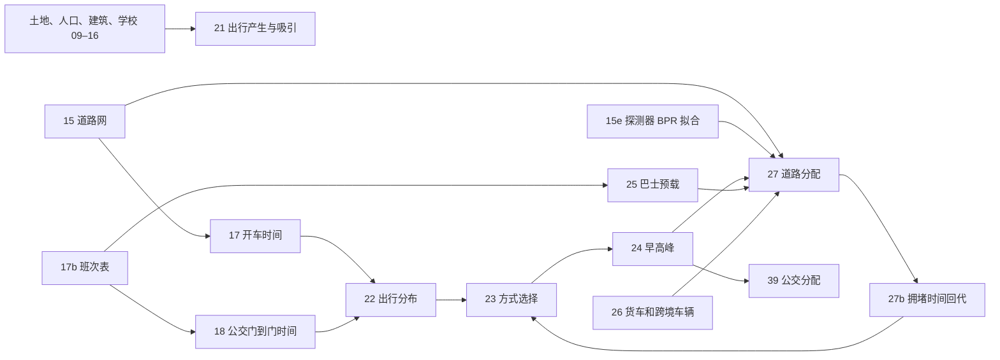

# TransitLab HK 推算方法总目录

> 由 Codex 按 `docs/for-codex/task-43-methods-catalogue.md` 只读整理（2026-09-28），Claude 核对并补入同日修正。英文版：[`methods-catalogue.en.md`](methods-catalogue.en.md)。代码行号以 2026-09-28 版本为准，之后改动代码可能偏移几行。

> 代码与审计快照：本机 `F:\transitlab-hk`，2026-09-28 只读核查。此文说明**现行文件**，不是建议重新运行管线。行号均指该快照；参数以 `data/model/*.json` 与 `data/web/*-audit.json` 为准。机动化出行不包括全程步行和单车（`pipeline/21_trip_generation.py:17-19`）。缩写 HBW 上班、HBS 上学、HBO 从家出发的其他目的、NHB 非家出发、CBS/CBR/CBV 跨境学童/居民/访客。

**读式提示。** 下文都用普通文字和符号，不需要公式渲染器：“Σ”读作“把这些数相加”，“÷”读作“除以”，“^2”表示平方；`exp(−β × 时间)`表示时间越长，出行权重越小。看不懂某个符号时，先读紧接着的“符号/单位”和“白话”。

## 一页总览

- **第 1 阶段**决定每区产生、吸引多少人次；**第 2 阶段**决定去哪里；**第 3 阶段**决定开什么车或坐哪类车；**第 4 阶段**把早高峰车辆和公交乘客放到网络上。27b→23→24→27 反复对齐出行选择和拥堵。
- 一般要先看 `00_步骤分类.md`，再按下面 A 主链→B 输入计算→C 旧沙盘与快速演示阅读。课程来源与页码见 `01_课程要点.md`。

# A. 四阶段主链方法卡

## A15 道路网：给时间和容量一副骨架

**位置。** 读运输署道路、OSM 车道、分区中心和土地格网；产出 `road-links` 与 `road-connectors`，供 17、25、27 使用。

**方程。**

> **计算式：** 路段通行能力 = 按道路等级、车道数、是否有中央分隔查容量表。

符号/单位：c_ℓ 为道路方向设计流量（辆/小时），n_ℓ 为该方向车道数（条）；道路等级与分隔状态无量纲。白话：按道路等级查 TPDM 第二册表 2.4.1.1，再结合车道数定每小时最多能承受多少车。**出处** `pipeline/15_road_network.py:100-108,225-234`。本模型：快速公路 1/2/3/4 车道为 1500/3000/4700/6300；主要干路分隔每道 1400，未分隔 1 道 1000、其余每道 1250；区内干路 1 道 850、其余每道 975；地方路每道 400；数值是代码表，路网中位数见 `data/web/road-network-audit.json:report`。

> **计算式：** 路段自由流时间（分钟）= 60 × 路长（米）÷（1000 × 速度〔公里/小时〕）。  
> 分区接驳时间（分钟）= 60 × 接驳距离（米）÷（1000 × 25）。

符号/单位：L_ℓ,d_zn 米，限速 u_ℓ 公里/小时，t 分钟。白话：路段按距离除速度算空路时间；小区到路口则按 25 km/h 的慢速进出。**出处** `pipeline/15_road_network.py:353-363` 与 `pipeline/17_car_skim.py:83-89`。本模型无公布限速时取 50 km/h（`pipeline/15_road_network.py:85`）；接驳 25 km/h（`pipeline/17_car_skim.py:48`）。

> **计算式：** 涉水距离 = 每个采样段的长度 ד该段落在海或水塘”的标记，再把各段相加。  
> 只接受涉水距离 ≤ 30 米的接驳线。

符号/单位：L 接驳直线米数，N 采样段数，涉水距离为累计涉水米数；指示函数无量纲。白话：沿直线每约 10 米看一次，跨水累计多于 30 米就换路口。**出处** `pipeline/15_road_network.py:494-513,556-569`；阈值 `pipeline/15_road_network.py:150`。审计：跳过 867 个候选，最终 0 个小区保留跨水接驳（`data/web/road-network-audit.json:report`）。

**拟合/校准。** 无统计拟合；OSM 缺车道时按等级默认（`pipeline/15_road_network.py:98-99`）。**核对。** 36,471 路段、452/455 小区接入；车道来源和等级分布见 `road-network-audit.json`。**局限。** 只有 9.3% 路段有单独公布限速；容量是 TPDM 设计值，仍需观测验证；3 个离岛小区无公路连接。

## A15e BPR 拟合：车多会慢多少

**位置。** 读 05 的探测器逐小时车流车速和 15 的容量；把参数写入 `bpr-parameters.json`，27 使用。

> **计算式：** 每组实测时间倍数 y ≈ 1 + α ×（流量/容量）^β。  
> 固定 β 后，α = Σ〔每组样本数 × x^β ×（实测倍数−1）〕÷Σ〔每组样本数 × x^(2β)〕。  
> RMSE = √〔Σ（每组样本数 × 预测误差²）÷总样本数〕。

符号/单位：x=v/c 无量纲，v 辆/小时，c 辆/小时，y=t/t_0=u_night/u_hour 无量纲，n_b 为组内探测器小时数，α,β 无量纲。白话：把同样拥挤程度的路放一组，看它们实测慢多少，按每组样本量拟合一条曲线。**出处** `pipeline/15e_bpr_calibration.py:65-83`。本模型：β=2 固定、α=0.3776，0.1 宽分组且每组至少 20 个，深夜 1–4 时作自由流（`pipeline/15e_bpr_calibration.py:40-42,70-79`；`data/model/bpr-parameters.json`）。

**拟合/校准。** 20 个工作日、680 探测器、16,225 个探测器小时；按组均值做加权最小二乘。固定 β=2 是因为任其自由拟合约为 1.3，但路中探测器看不到路口排队，过低的指数也会让分配堆满道路（`pipeline/15e_bpr_calibration.py:17-24`）。一次闭式求 α，无迭代停止条件。**核对。** RMSE 0.0304，旧教科书 0.15/4 的 RMSE 0.0841（`data/web/bpr-calibration-audit.json`）。**局限。** 637/680 个探测器在快速路，却把同一曲线用于所有等级；路口延误可能更陡。

## A17 开车阻抗矩阵

**位置。** 读 15 道路网和 16 分区顺序，给 22、23、26 提供空路 OD 时间、距离、沿途收费。

> **计算式：** 分区 i→j 的自由流时间 = 所有可行道路路线中，各路段自由流时间之和的最小值。  
> 区内时间 = 到最近其他分区的自由流时间的一半。

符号/单位：i,j 为交通分区，p 为可行路径，t 分钟。白话：每对分区走时间最短的路；区内出行用最近外区一半时间近似。**出处** `pipeline/17_car_skim.py:97-118,121-128`。本模型接驳 25 km/h；455×455 对，2,718 对不可驾车，均涉及 3 个无路分区（`data/web/car-skim-audit.json`）。

**拟合/校准。** 无；最短路是确定性计算。**核对。** 抽样屯门→中环 26 分、沙田→尖沙咀 12 分（空路；`car-skim-audit.json:report`）。**局限。** 此步收费只记录、不影响路径；禁转不在此步执行；这是空路而非拥堵行车时间（`pipeline/17_car_skim.py:12-22`）。

## A18 公交门到门阻抗矩阵

**位置。** 读 17b 合并 GTFS、OSM 步行网及 15 分区中心；向 22、23 送公交、步行、单车 OD 时间。

> **计算式：** 公交门到门时间 = R5 根据步行进站、候车、车上、换乘、步行出站和时刻表算出的时间（07:30–08:30 窗口）。

符号/单位：t_ij^PT 分钟；各组成均为分钟。白话：从家门口走到站、等车、坐车、换车，再走到目的地。这里是 **R5 内部路径/时刻表计算的组成说明**，不是本仓库手写的逐项相加函数。**出处** `pipeline/18_transit_skim.py:11-17,302-308`。本模型：2026-09-22 07:30 起 60 分钟窗口的中位数；步行 3.6 km/h、骑车 12 km/h（`pipeline/18_transit_skim.py:83-90`）。

> **计算式：** 步行接驳补算时间（分钟）= 60 × 1.3 × 直线距离（米）÷（1000 × 3.6）。

符号/单位：d 为无法路由的直线接驳距离（米），t 分钟。白话：步道缺连接时，把直线加 30% 绕路后按步速算。**出处** `pipeline/18_transit_skim.py:218-246`；参数 `pipeline/18_transit_skim.py:89,94`。

**拟合/校准。** 无；按 GTFS 与 R5 求时刻表路径。**核对。** 公交 3 小时内仅 4 对不可达；公交时间不应长于直接步行，违反 0 对（`data/web/transit-skim-audit.json`）。**局限。** 93% 班次按班距随机取时刻，重算同一 OD 可差约 1–2 分；未计车厢拥挤及额外换乘厌恶。

## A20 调查行为参数抽取

**位置。** 从 TCS 2022 正文和附录读取出行率、均时、车拥有率、时间价值、班次/时段比例，写 `parameters-tcs2022.json` 供 21–24、27b 使用。

> **计算式：** 某目的、某地区的人均出行率 = 该目的出行人次 ÷ 对应人数。  
> 某目的在第 h 小时的比例 = 该小时图形面积 ÷ 全天 24 小时面积之和。

符号/单位：Q 人次/日，N 人、就业者或学生，r 人次/相应单位/日；F 为图中逐小时面积，s 为无量纲份额。白话：把调查表中的出行数除以相应人群，图 3.3 的 24 小时面积读成一天的比例。**出处** `pipeline/20_behaviour_parameters.py:227-249,328-365` 与使用端 `pipeline/21_trip_generation.py:226-239`。本模型全港原表 HBW 1.36 次/就业者、HBS 1.05 次/学生、HBO 0.70 次/人、NHB 0.13 次/人；8–9 时约 13.1%（`data/web/tcs-parameters-audit.json:report`）。

**拟合/校准。** 本步是抽表、图形取数与加总核对，非行为模型拟合。**核对。** 表 3.3 各目的 12,363,000 人次与总计一致；图 3.3 全天 100.0%。**局限。** 调查不提供纯步行总量和步速；附录若干表的 PDF 文本栏交错，代码用页内数值存在性复核（`pipeline/20_behaviour_parameters.py:29-48`）。

## A21 第一步：出行产生与吸引

**位置。** 读 16 的 2026 年人口、就业者、学生、楼面，20 的调查参数，13 的口岸流量；产出 470 个内外分区的出行端点，供 22 与楼宇加权中心使用。

**方程。**

> **计算式：** 分区产生人次 = 2026 年对应人口 ×（2022 年调查人次 ÷ 2022 年对应人口）× 口径修正系数。

符号/单位：P_ip 为小区 i、目的 p 的人次/工作日；N 为人/就业者/学生；Q 为大区 d 调查人次/工作日；φ_p 为口径修正，无量纲。白话：先看调查中每名工人、学生或居民平均出行几次，再乘小区相应人口。**出处** `pipeline/21_trip_generation.py:226-240`。本模型 φ_HBW=1.0362,φ_HBS=1.0912,φ_HBO=0.9983（`data/web/trip-generation-audit.json:production_rates_2022`）。

> **计算式：** 回归预测量 = 各解释变量 × 各自系数后相加；求使“预测−观测”平方和最小、且所有系数 ≥ 0 的系数。  
> R² = 1 − 残差平方和 ÷ 观测相对均值的平方和。

符号/单位：y_d 为大区岗位数或目的出行吸引人次/日，X_dk 是楼面 m²、学额或人口，θ_k 为相应每 m²、每学额或每人的岗位/人次系数；R^2 无量纲。白话：让办公楼、商铺等各自贡献非负吸引量，找一组系数把各大区的已知数解释得最好。**出处** `pipeline/21_trip_generation.py:261-275,291-305,327-335`。岗位以 18 区规划署就业拟合，R^2=0.9353；办公/零售/工业/酒店约 0.045897/0.041316/0.010473/0.029595 岗位/m²，居民 0.200135 岗位/人（`trip-generation-audit.json:jobs`）。其他目的在 26 个调查大区拟合，HBS/HBO/NHB 吸引 R^2=0.9103/0.766/0.753（同审计 `:attractions.fits`）。

> **计算式：** 分区吸引人次 = 本区 2026 年相对权重 ×（调查大区吸引总数 ÷ 该大区 2022 年权重之和）×（全港产生总数 ÷ 尚未平衡的吸引总数）。

符号/单位：A,P,Q 人次/日；w 为楼面、学额等经回归得到的相对权重（量纲随目的变）；最后比值无量纲。白话：调查规定每个大区的总吸引，回归只负责把它分到区内小区；全港最后再配平到产生总数。**出处** `pipeline/21_trip_generation.py:347-364`。配平倍数 HBW/HBS/HBO/NHB 为 0.944/0.941/1.012/1.022（`trip-generation-audit.json:attractions.balance_factors`）。

**拟合/校准。** 观测：TCS 2022 附录 A.1/A.2 的 26 大区人口与人次、规划署 TPEDM 2021 年 18 区就业。参数：不同用地的非负回归系数，算法 SciPy `nnls`（列先按最大值缩放）；`nnls` 的数值迭代细节由库实现，仓库未自行设停止阈值。**核对。** 2026 本地机动化 12,310,384 人次，比 2022 调查 12,363,000 低 0.4%；另有跨境 905,720（`trip-generation-audit.json:report`）。**局限。** 原调查在疫情期间口岸关闭；跨境住户按人口、访客按零售+酒店分布是假设；元朗 2021→2026 就业 +56% 是规划推算而非实测（`pipeline/21_trip_generation.py:43-50`）。

## A22 第二步：出行分布

**位置。** 读 21 出行端点与 18 公交 OD 时间；输出各目的 OD 人次给 23。

**方程。**

> **计算式：** OD 人次 = 起点产生 × 终点吸引 × 两端配平系数 × exp(−β × 公交时间) × 过海系数^是否过海 × 区内系数^是否区内。

符号/单位：T,O,D 人次/日，a_i,b_j 配平乘数，c_ij 公交分钟，β_p 分钟⁻¹；H_ij 跨海指示、I_ij 同主要地区指示，K,S 无量纲。白话：人多的起点和有吸引力的终点更容易相连；时间越久越少，过海和区内另作修正。**出处** `pipeline/22_trip_distribution.py:192-203,137-149`。本模型 β_HBW/HBS/HBO/NHB=0.04667/0.08108/0.08460/0.06946 分钟⁻¹，K=0.6170；沙田/马鞍山区内 S=2.3418（`data/web/trip-distribution-audit.json:purposes,harbour_factor_k,area_factors`）。

> **计算式：** 行配平系数 = 该行目标产生 ÷ 该行目前加权和。  
> 列配平系数 = 该列目标吸引 ÷ 该列目前加权和。  
> 种子权重 = exp(−β × 时间) × 过海修正 × 区内修正。

符号/单位：a,b 配平乘数，W 无量纲，O,D 人次/日。白话：反复按行、按列拉到指定总数，像把一张表的行列同时对齐。**出处** `pipeline/22_trip_distribution.py:137-149,201-203`。最多 500 轮，最大相对行误差 < 10^-4 停（`pipeline/22_trip_distribution.py:83,137-148`）；当前四个目的误差 6.5–9.9×10^-5（`trip-distribution-audit.json:purposes`）。

> **计算式：** 模型平均出行时间 = Σ（OD 人次 × OD 时间）÷ Σ（OD 人次）。  
> 校准目标时间 = 调查自报均时 ×（45÷42）÷时间换算系数 r。  
> 新区内系数 = 旧系数 ×（调查区内 odds ÷ 模型区内 odds）；odds = 区内份额 ÷（1−区内份额）。

符号/单位：c,c^* 分钟，r 无量纲自报/引擎时间比，q_a 为调查区内份额，q̂_a 为模型区内份额，S_a 无量纲。白话：先让模型平均时间贴近调查（考虑公交相对于全方式的时间与自报误差）；再用“留在区内”的 odds 比率修正每个地区。**出处** `pipeline/22_trip_distribution.py:159-161,183-199,205-218,324-340`。本模型 r=1.2803；港岛 S=1，因其自给率与过海比例约束重复（`pipeline/22_trip_distribution.py:94-98`）。

**拟合/校准。** 每目的 β：几何中点二分至上下界比 <1.002，使平均时间等于 c_p^*；每试一个 r，过海 K 二分 12 次以对准 TCS 表 3.4 的 15.9%；r 在 1.0–1.6 用黄金分割到区间宽 <0.01，目标是表 3.4 其余四类地域比例与表 3.5 十区自给率的百分点 RMSE；最后九区 S 逐轮 odds 更新，最大 12 轮、最大差 <0.5 个百分点或改善 <0.1 点停（`pipeline/22_trip_distribution.py:205-256,290-340`）。审计只保存 r 搜索的 10 个试点和最终误差，**九区实际轮数未核实**，交接文档称 5 轮（`docs/handoff.md:7-10`）。最终 RMSE 0.529 个百分点（`trip-distribution-audit.json:misfit_pts`）。

**核对。** 沙田/马鞍山自给率 31% 对调查 31%，过海 15.9% 对 15.9%；但 30 分钟内仅 30% 对调查 48%，调查按全方式、这里按公交时间，口径不同（`trip-distribution-audit.json:report`）。**局限。** 区内系数替代尚未建模的铁路拥挤；口岸 OD 沿用 HBO 衰减，仍属占位；r 是统一自报时间换算，不代表每个目的都相同。

## A23 第三步：方式选择

**位置。** 读 22 OD、17 开车/18 公交阻抗、27b 延误、TCS 车拥有率与时间价值；输出 PV 私家车、TAXI 的士、PT 公交、SPB 专用巴士人次给 24。

**方程。**

> **计算式：** 广义费用（分钟）= 行程时间 + 金钱费用 ÷ 时间价值。  
> 方式效用 = 方式常数 − 时间敏感度 × 广义费用。  
> 方式概率 = 该方式 exp(效用) ÷ 所有可用方式 exp(效用) 之和。

符号/单位：G,t 广义分钟，F 港元，VOT 港元/分钟，λ 分钟⁻¹，ASC,V,P 无量纲；M_g 为有车或无车群可用方式。白话：把钱按时间价值换成分钟，时间加费用越低，选择概率越大；没车的群体不能选私家车。**出处** `pipeline/23_mode_choice.py:387-420`。各方式具体 G：PV = 开车+两端各 5 分钟步行+收费/VOT；TAXI = 开车+0.1713×(车费+隧道费)/VOT；PT = 门到门+近似票价/VOT；SPB = 开车。塞车开车时间=空路+w_p×早高峰延误（`pipeline/23_mode_choice.py:387-395`；`data/web/mode-choice-audit.json:taxi_fare_weight`）。

> **计算式：** 新方式常数 = 旧方式常数 + ln（目标人次 ÷ 模型人次）。

符号/单位：ASC 无量纲，N 人次/日。白话：某方式人数偏少就调高它的常数，偏多就调低，直到四方式总量贴齐调查。**出处** `pipeline/23_mode_choice.py:423-436`。每目的最多 200 轮，最大相对差 < 10^-4 停；PT 常数固定为 0（`pipeline/23_mode_choice.py:165,423-435`）。

> **计算式：** 寻找时间敏感度 λ，使“额外增加 15、30、45 分钟”三种情景的模型换方式比例与调查比例之间的均方根误差最小。

符号/单位：e 延长分钟，s 改方式比例，λ 分钟⁻¹。白话：问卷说“多 15/30/45 分钟会不会换方式”，用这三点找选择对时间变化的敏感度。**出处** `pipeline/23_mode_choice.py:449-467,509-521,545-568`。本模型 λ=0.0637366/广义分钟；RMSE 7.2%（`data/web/mode-choice-audit.json:sensitivity_per_min,report`）。

**拟合/校准。** 有车比例按 TCS 表 4.2 公屋/资助出售/私楼 5.5/12.1/25.1% 与区住房构成推，再按附录 A.4 的 26 区比例缩放；有车住户比例 17.3%，按户人数换成人口 21.2%（`pipeline/23_mode_choice.py:187-240`；`mode-choice-audit.json:report`）。VOT 用 TCS 表 E.6 随住户中位收入 28,300→30,000 港元调整；PT 票价用港铁 8,750 对站点拟合约 5.68+0.84d_straight 港元（`pipeline/23_mode_choice.py:245-288`）。λ 用黄金搜索精度 0.002；的士车费权重用几何中点二分至高/低比 <1.01，目标是的士占 PV+TAXI 车公里与普查一致；两项交替最多 3 轮，变化分别 <0.003 和 <0.02 停（`pipeline/23_mode_choice.py:484-558`）。目标方式份额来自 TCS 附录 A.3；的士总数另锚定运输署最近 12 月平均 687,995 人次/日，扣跨境目标后本地 582,453（`pipeline/23_mode_choice.py:365-385`；`mode-choice-audit.json:report`）。

**核对。** 的士车公里份额 25.39% 对普查 25.41%；方式份额最大偏差 < 10^-4；的士工作日折回全日 686,877 对官方 687,995，差 −0.2%（`mode-choice-audit.json`）。**局限。** PT 票价拿港铁距离关系代表巴士/小巴；停车、油钱和等待差异吸收到 ASC；TCS 表 5.2 “换方式”也包括巴士改港铁，现模型只分大类。

## A24 全日转早高峰

**位置。** 读 23 各目的/方式全日 OD；输出 08:00–09:00 人次和车辆矩阵给 27、39。

> **计算式：** 早高峰 OD 人次 = 目的时段份额 ×〔出发方向份额 × 全日 i→j 人次 + 回程份额 × 全日 j→i 人次〕。  
> 早高峰车辆数 = 早高峰人次 ÷ 每车载客人数。

符号/单位：T 人次/日，H 人次/小时，f_p 逐时份额，d_p 由家/产生端出发份额，o_m 人/车，V 辆/小时。白话：一天的 OD 按早 8–9 点占比切出来，再按出发方向调转回程，最后除每车人数。**出处** `pipeline/24_peak_hour.py:98-113,165-171,185-186`。本模型 f_HBW/HBS/HBO/NHB=21.2/11.9/6.4/8.0%；d=99/100/70/50%；o_PV/TAXI/SPB=1.31/0.98/11.42（`data/web/am-peak-audit.json:report`）。

> **计算式：** 修正后某方式高峰人次 = 按调查估算的高峰人次 ×（该方式普查高峰比例 ÷ 该方式调查高峰比例）。

符号/单位：H 人次/小时，f 无量纲时段份额。白话：调查的所有交通一起算高峰会让汽车过多，所以用交通普查的车种高峰份额再修一次，多出的人转给 PT。**出处** `pipeline/24_peak_hour.py:188-203`。PV/TAXI/SPB 调整倍数约 0.61/0.66/0.83（`am-peak-audit.json:report`）。

**拟合/校准。** 普查 2024 核心站逐小时 AADT 与车种组成，按站车流加权得 f_m^census；非迭代比率校准。**核对。** 高峰机动化 167 万人次；转入 PT 128,949 人次后 PT 139.1 万；车辆 PV 10.18 万、TAXI 4.50 万、SPB 0.85 万（`am-peak-audit.json:report`）。**局限。** HBO 70% 从家出发是显式假设（`pipeline/24_peak_hour.py:85`）；车种时段修正保住全方式合计，但 PT 得到了转移差额。

## A25 巴士预载

**位置。** 读 17b 时刻表、15 路网、15c 普查站配对；把固定班次车流写到每道路方向，供 27 与车流普查比较。

> **计算式：** 班次数 = 在指定时窗内，按首班时间和班距发出的车辆数（至少为 0）。  
> 某路段巴士预载 = 所有经过该路段的线路班次相加。

符号/单位：t、h 秒，N_h 为 8–9 点站间发车次数，v^bus 辆/小时。白话：先按班距数出这一小时有多少班，再把每班沿两站间最快道路放到经过的路段上。**出处** `pipeline/25_bus_preload.py:107-129,204-245`；班次时间点为固定时刻则直接数（`pipeline/25_bus_preload.py:123-129`）。本模型 1,709 条运行线路、8–9 点巴士 88,432 个站次、小巴 57,338 个站次（`data/web/bus-preload-audit.json:report`）。

**拟合/校准。** 不拟合：班次为固定背景车流，最短路铺线。**核对。** 113 核心站，专营巴士模型/普查 0.84，GEH<5 为 79%；专线小巴对普查所有小巴 0.76（`bus-preload-audit.json:report`）。**局限。** GTFS 缺公交道路走线，因此站间用最短路；缺出回厂空车、居民巴士、红小巴（`pipeline/25_bus_preload.py:18-32`；`docs/handoff.md` 顶部）。

## A26 货车及跨境车辆

**位置。** 读 2011 货车调查、2026 领牌数/口岸流量、17 空路时间；产出全天及 8–9 点货车 OD 给 27。

> **计算式：** 货车起点量/终点量 = 各类土地活动量 × 相应地区出行率后求和。  
> 货车 OD = 起点量 × 终点量 × 两端配平系数 × exp(−β × 行程时间) × 过海修正。

符号/单位：q_ik 为住宅、零售、工业等数量（户或 m²），r 为辆次/户或辆次/m²，O,D,T 辆次/工作日，c 空路分钟，β_g 分钟⁻¹，K_g 无量纲。白话：先用不同土地用途的货车出行率估计起终点，再像客运重力模型一样按距离分配，并对海港另加阻抗。**出处** `pipeline/26_goods_and_boundary_vehicles.py:394-424,433-436,351-361`。当前 β_van/lgv/heavy=0.131/0.139/0.152 分钟⁻¹，K=0.32（`data/web/goods-audit.json:beta,harbour`）。

> **计算式：** 调查均时对应的空路目标时间 = 自报时间 ÷ ρ。  
> 地域误差 = √〔15 个地域份额误差平方和 ÷ 15〕。  
> 轻型货车联合误差 = √〔（地域误差÷0.01）² +（ln〔模型车公里÷目标车公里〕÷0.15）²〕。

符号/单位：c^*,t 分钟，ρ、s、E 无量纲，VKM 车公里/日。白话：调查自报时间比空路长，先除一个 ρ 再拟合衰减；轻型货车还要同时顾及跨区比例与每天开了多少公里。**出处** `pipeline/26_goods_and_boundary_vehicles.py:441-452,485-512`。当前 ρ_light=2.73、ρ_medium/heavy=3.43（`goods-audit.json:rho,rho_heavy`）。

**拟合/校准。** 观测 GVTCS 2011 表 4.3 的 15 个地域 OD 份额、附录 A.2 起终点、表 E.4 轻型货车年里程及运输署 2026 领牌数。每组 β 二分 30 轮使模型均时接近 t^reported/ρ；过海 K 二分 14 轮使海港份额一致；先用表 4.3 黄金搜索 ρ（区间宽 <0.02）定中重型，再固定它并联合里程定轻型（`pipeline/26_goods_and_boundary_vehicles.py:441-452,473-536`）。**核对。** 最大地域份额差 2.2 个百分点；轻型车公里 491 万/日，对年里程推算目标 540 万/日，比值 0.91（`goods-audit.json:report`）。**局限。** 2011 调查行为假设延续至 2026；轻型目标年里程含周末、跨境段；无道路离岛不产生货车。

## A27 道路分配与审计

**位置。** 读 15 路网和容量、15e BPR、24 客车、25 巴士预载、26 货车；产出拥堵路段时间和车流，供 27b、普查核对。

> **计算式：** 路段拥堵时间 = 自由流时间 ×〔1 + α ×（车流÷容量）^β〕。  
> 某车种感知成本（分钟）= 路段时间 + 收费权重 × 收费（港元）÷该车种时间价值。

符号/单位：t,C 分钟，v,c 辆/小时，F 港元，VOT 港元/分钟，ω、α、β 无量纲。白话：路越满就越慢；收费折成司机愿意花多少分钟绕开。**出处** `pipeline/27_road_assignment.py:82-90,290-313`；`pipeline/15e_bpr_calibration.py:9,75-83`。现行 α=0.3776,β=2,ω=0.20；VOT 私家车/的士/轻型/中重型货车 1.26/0.87/2.74/4.06 元/分（`data/web/assignment-audit.json:bpr,toll_weight,values_of_time`）。注意 27 文件开头第 30 行仍写旧 0.15/4，**实际执行按 84–86 行读取现行 JSON**。

> **计算式：** 在所有满足 OD 守恒的路网车流中，最小化“各路段从 0 到当前车流的时间函数积分”之和。  
> 对 BPR 曲线，单路段积分 = 自由流时间 ×〔车流 + α × 车流^(β+1) ÷〔(β+1) × 容量^β〕〕。

符号/单位：v 辆/小时，积分量纲为车·分钟/小时，F 为满足 OD 与路网守恒的可行车流。白话：Wardrop 均衡时，被使用的路线没有谁单独改路能更快；Beckmann 积分把这件事写成可求最小值的形式。**出处**：仓库通过 `pipeline/27_road_assignment.py:299-313` 调用 AequilibraE 的 BPR + `bfw`，上式是该调用所代表的**标准数学形式**，仓库未手写积分和 BFW 更新；多车种收费固定成本由 300–302 行另加。精确的库内目标及相对间隙分母定义**未核实**。β=2 时积分中的幂为 3（由 BPR 代入）。

> **计算式：** 调整后容量 = 原容量 ×（1−重车折减率）。  
> 重车份额 ≤15%：折减 0；15%–20%：折减 7%；>20%：折减 10%。

符号/单位：h 为中重货及巴士所占车辆份额，c,c' 辆/小时，r 无量纲。白话：重车多时，同样道路少装些车；第一次求流量、改容量后再分配一次。**出处** `pipeline/27_road_assignment.py:79-81,349-373`。>25% 沿用 10% 折减，是 TPDM 表 2.4.1.2 范围外的外推；本次第二轮 19 次 BFW 迭代、相对间隙 9.2×10^-4（`assignment-audit.json:report`）。

> **计算式：** 隧道串的 α = 普通 α × max〔1，6 分钟÷隧道串自由流时间〕。  
> GEH = √〔2 ×（模型流量−普查流量）² ÷（模型流量+普查流量）〕。

符号/单位：t^0_chain 分钟，M,C 模型/普查辆/小时，其他无量纲。白话：隧道入口很短，普通 BPR 算不出排队；整串隧道至少按 6 分钟“时间底座”放大延误。GEH 则用一种兼顾绝对与相对差的数比较车流。**出处** `pipeline/27_road_assignment.py:155-200,389-405`。TUNNEL_QUEUE_MIN=6 分钟（`pipeline/27_road_assignment.py:88`；`assignment-audit.json:tunnel_queue_min`）。

**拟合/校准。** 五类车辆同时求用户均衡；算法 AequilibraE 双共轭 Frank-Wolfe（BFW），相对间隙目标 10^-3、最多 100 次（`pipeline/27_road_assignment.py:89-90,303-313`）。收费权重按隧道计数扫 1.00/0.60/0.35/0.25/0.20/0.15/0.10 后选 0.20；隧道排队扫 0/6/12/20 分选 6（`pipeline/27_road_assignment.py:87-108`；`docs/handoff.md` 顶部）。**核对。** 第二次分配 19 次迭代、相对间隙 9.2×10^-4；191 个高峰计数方向 GEH<5 18.3%（目标 85%），总量比 0.960；17 个走廊站 GEH<5 29.4%（目标 60%）（`assignment-audit.json`）。**局限。** 455 小区模型使支路流量仅普查的 0.22；走廊指标也未达标；路口排队没有显式排队论模型，隧道 6 分是校准代偿。

## A27b 拥堵时间回代

**位置。** 从 27 已分配道路时间重算 OD 早高峰延误，送回 23；`feedback_loop.py` 控制循环。

> **计算式：** OD 延误 = 去程与回程各自“拥堵时间−空路时间”的非负部分再平均。  
> 目的时段权重 = Σ〔该目的每小时出行份额 ×（该小时车流÷08:00 车流）^β〕，β 与道路分配的塞车曲线相同（现为 2）。  
> 回代汽车时间 = 空路时间 + 时段权重 × OD 延误。

符号/单位：t,Δ 分钟，s 各目的小时份额，q 普查逐小时车流，w 无量纲。白话：把早高峰比空路多花的时间两方向平均；不同目的全天出行时段不同，按当小时车流加权回代。**出处** `pipeline/27b_congested_skim.py:58-69,112-115`、`pipeline/23_mode_choice.py:324-334,387-395`。当前 w_HBW/HBS/HBO/NHB=0.804/0.801/0.743/0.811（`data/web/congestion-feedback-audit.json:weights`）。**2026-09-28 修正**：本目录初稿指出这里的指数写死为 4、而现行 BPR 指数是 2，两者不一致；已改为直接读 `bpr-parameters.json` 的 β，权重由 0.701/0.657/0.591/0.681 升到上列数值，重跑回代后 1 轮稳定（相差 0.7%），走廊与港铁结果基本不变（东铁 1.36→1.37）。

> **计算式：** 第 k 轮使用的延误 = 上轮延误 +（本轮分配延误−上轮延误）÷k。  
> 稳定差值 = Σ〔车辆数 ×   
> 本轮分配延误−已使用延误  
> 〕÷Σ〔车辆数 × 本轮分配延误〕。

符号/单位：k 轮数，V 早高峰私家车+的士辆次，g 无量纲。白话：每轮只取新结果的 1/k，避免一会儿太堵、一会儿太空；人次加权差低于 5% 就停。**出处** `pipeline/27b_congested_skim.py:126-147`；驱动顺序 `pipeline/feedback_loop.py:42-54`。

**拟合/校准。** 这是固定点反馈而非观测数据拟合。每轮 27b→23→24→27→27b --check，最多 5 轮；停止 g<0.05。当前 1 轮稳定，g=0.0325；新分配延误 1.83 分/车次，23 用 1.82（`congestion-feedback-audit.json:history,last_disagreement,report`）。**核对。** 走廊 GEH<5 29.4%，见 27。**局限。** 只回代汽车平均延误，未把铁路拥挤回代；27b 的时段外推四次幂与新 BPR 二次幂不同。

## A39 公交最优策略分配

**位置。** 读早高峰公交 OD 和 GTFS，把客流分到每条线路每段，核对立法会港铁繁忙段。

> **计算式：** 班次总数 = 首班时间 + k×班距落在 07:30–09:30 时窗内的车次个数。  
> 巴士车上时间 = GTFS 车上时间 × 1.5。

符号/单位：h_r 秒/班，n_r 班次，t 分钟。白话：按班距把模板扩成实际班次；巴士/小巴车上时间乘 1.5 表示高峰堵车与时刻表过于理想。**出处** `pipeline/39_transit_assignment.py:112-127,248-255`，系数 `pipeline/39_transit_assignment.py:53-54`。港铁班距另按官网覆写（如东铁主干 209 秒、港岛线 114 秒，`pipeline/39_transit_assignment.py:47-51,80-87`）。

> **计算式：** 在可乘线路集合中，某线路先到概率与其班次频率成正比；频率与班距成反比。

符号/单位：f_r 班/小时，h_r 秒/班，P 无量纲。白话：站台上多条可用线先来哪条坐哪条，班更密的更容易先到；等待越短、车上越快的线路更有吸引力。**出处** `pipeline/39_transit_assignment.py:11-12,301-307`（AequilibraE `optimal-strategies`，频率字段 `freq`）。**具体候车时间的库内公式未核实**，本仓库只向库传频率，不应把 h/2 冒充该库实际公式。

**拟合/校准。** 巴士乘数按 7 条港铁繁忙段扫描，×1.0/1.3/1.6/2.0 总体偏差 0.54/0.25/0.22/0.34，采用 1.5；扫描到采用值之间的插值规则**未核实**（`pipeline/39_transit_assignment.py:53-54`）。港铁班距来自代码表、非校准。最优策略由库计算，无项目级收敛阈值。**核对。** PT 139.10 万人次，进网 136.82 万（98.4%）；东铁太围→九龙塘 60,779 对立法会 44,600，比例 1.363（`data/web/transit-assignment-audit.json:report,mtr_check`）。**局限。** 尚无车厢拥挤反馈；东铁几乎满载；部分立法会对照年份早于本模型 2026。

# B. 为主链供数的计算方法卡

## B09 建筑楼面

**位置。** 建筑原始占地、高度与公布层数→建筑楼面→10、14、21。**方程。**

> **计算式：** 建筑毛楼面 = 占地面积 × 层数。  
> 缺层数时：层数 ≈ 建筑高度 ÷ 对应高度档的典型层高，再取整数。

符号/单位：GFA,A m²，H, h m，n 层；白话：先用已公布层数的楼估出每层多高，缺层数的楼再用高度反推。**出处** `pipeline/09_building_stock.py:118-154,166-184`。本模型可信层高 2–8 m、分组样本不足 50 栋取 3.3 m/层、最高 120 层（`pipeline/09_building_stock.py:52-61`）。**拟合/校准。** 在公布层数且高度相符楼宇上，按占地面积档取中位层高；低于 15 m 的楼按“占地档×整数米”中位层数查表（每格至少 50 栋）；无优化迭代。**核对。** 公布层数约占 25%（`data/web/zones-attraction-audit.json:report`）。**局限。** 楼面是占地×层数的毛楼面近似，非逐栋实测 GFA。

## B10 各分区用途楼面

**位置。** 09 建筑楼面+屋宇署用途+差饷估价署区级楼面→小区办公/零售/住宅等 GFA→21。**方程。**

> **计算式：** 某区未分类商办楼的办公比例 = 官方办公内部楼面 ÷（官方办公 + 零售内部楼面）。  
> 分区某用途楼面 = 区内该用途各栋楼的楼面之和。

符号/单位：IFA,GFA m²，s 无量纲；白话：用途不明的商办楼按区级官方办公/零售比例拆，再逐栋落入小区。**出处** `pipeline/10_zone_attraction.py:169-184,257-263`。**拟合/校准。** 按 18 区 RVD 比例设目标，整栋楼从大到小累加到目标；非最小二乘，无迭代阈值。**核对。** 本模型毛楼面/RVD 内部楼面中位：办公 1.39、零售 1.13、工业 1.63；455/455 区有建筑（`data/web/zones-attraction-audit.json:report`）。**局限。** 33.8% 楼面无用途；毛楼面与内部楼面口径不同。

## B11 学额空间分配

**位置。** 教育局学校点位与区级在校人数→小区学额→16、21。**方程。**

> **计算式：** 每所学校分配学额 = 该区该级别学生总数 ÷ 该区该级别学校数。

符号/单位：学额、人，N 所；白话：只有区级总数时，同级学校先均分，再按学校点位落区。**出处** `pipeline/11_zone_schools.py:174-202`。**拟合/校准。** 无参数搜索，按公布区级合计精确分摊。**核对。** 小学 317,233、中学 347,820、幼稚园 115,300，全数落区；385/455 区有学校（`data/web/zones-schools-audit.json:report`）。**局限。** 学额不是逐校公布，区内均分是估计。

## B12 大专与医院

**位置。** 院校/医院点位及楼面→小区高等教育学额与医院 GFA→16、21。**方程。**

> **计算式：** 某区院校权重 = 本区已命名院校楼面占比 + 本区校园点位占比。  
> 本区学额 = 官方学生总数 × 本区权重 ÷ 各区权重之和。

符号/单位：GFA m²，N 院校点数，w 无量纲，places 名；白话：学校名称出现在楼宇和院校点位两类证据里，两者各占一份相对权重，把官方学生总量摊到各区。**出处** `pipeline/12_zone_institutions.py:174-192`。**拟合/校准。** 官方专上学生总量作硬约束；非回归。**核对。** 官方 354,700，分区合计 354,698（取整差 2）；医院楼面 500 万 m²、约 166 m²/床（`data/web/zones-institutions-audit.json:report`）。**局限。** 校园租用商业楼面无法精确区分；楼面与点位仅用于权重。

## B14 拆分交通分区

**位置。** 211 普查小区、住宅楼面、铁路站→455 模型交通分区，供全链。**方程。**

> **计算式：** 子区人口/住户数 = 母区总数 × 子区住宅楼面 ÷ 母区各子区住宅楼面之和（取整时再用最大余数法）。

符号/单位：X 人/户等普查整数，GFA m²；白话：母区人口按住宅楼面分给子区；整数用最大余数法补齐，保证加总一点不差。**出处** `pipeline/14_split_zones.py:116-126,187-205`。**拟合/校准。** 铁路站为聚类种子、住宅楼面加权 k-means；目标人口 18,000/区、种子 20260916（`pipeline/14_split_zones.py:51-60,152-176`），不是调查拟合。**核对。** 23 个普查计数字段总量完全守恒；最大分区人口 47,847；每户住宅楼面 76 m²（`data/web/zones-split-audit.json:report`）。**局限。** 子区内人口分布是估计，边界和 19 个碎片新生于拆分。

## B15c 普查站与道路链接

**位置。** 07 普查站+15 路网→站点计数对应路段/方向→27 校核。**方程。**

> **计算式：** 站点某方向的模型车流 = 该站横断线覆盖的所有同方向道路链接车流之和。

符号/单位：M,v 辆/小时；白话：一个站的一方向可能横切多个并行车道，模型车流要全部加起来才能同普查站比。**出处** `pipeline/15c_census_links.py:22-29,113-134` 与 `pipeline/27_road_assignment.py:393-401`。**拟合/校准。** 无；优先路名、距离、方向，40 m 横断线找并行道，未按名匹配才用最近 30 m（`pipeline/15c_census_links.py:52-57,137-170`）。**核对。** 191 站、356 方向中 355 配上，50 个方向含并行路段；未配 1 个（`data/web/census-links-audit.json:report`）。**局限。** 高架与地面同址仍可能错配，未配东行站保留标记。

## B15d 逐小时道路速度

**位置。** 05 探测器车速+15 路网→每路段方向每小时车速，用于沙盘与供给核查。**方程。**

> **计算式：** 同类道路、同限速、同小时的速度修正比 = 探测器“实测速度÷限速”的中位数。  
> 未覆盖路段速度 = 该路限速 × 修正比。

符号/单位：u km/h，r 无量纲；白话：有探测器就用实测，没有的同类道路按“实测/限速”的中位比率推。**出处** `pipeline/15d_speed_profiles.py:167-182,198-220`。**拟合/校准。** 24 天中 20 个工作日，至少 5 天才取探测器小时中位；同类/限速/小时至少 3 个探测器，不够借类总中位；非回归（`pipeline/15d_speed_profiles.py:106-125,176-182`）。**核对。** 7.1% 路长有探测器，输出 1,144,632 行；早高峰全网中位 50 km/h（`data/web/road-speeds-audit.json:report`）。**局限。** 点速不含路口延误，50 km/h 市区路高峰偏乐观。

## B16 2026 土地利用与人口

**位置。** 14 分区+建筑/学校/院校与规划人口→2026 每区人口、年龄、就业和楼面→21、17。**方程。**

> **计算式：** 分区某年龄组新人数 = 规划人数 ×（统计处该年龄组全港总人数 ÷ 各区规划人数之和）。

符号/单位：N 人，a 年龄组；白话：规划署给空间分布，统计处 2026 实际总人数给全港锚点，各年龄组各自等比例拉齐。**出处** `pipeline/16_landuse_2026.py:186-200`；整数拆分最大余数法 `pipeline/16_landuse_2026.py:203-213`。**拟合/校准。** 统计处年龄组/总人口比例校准，一次缩放、无迭代；全区至子区按住宅楼面分摊。**核对。** 陆上 7,517,309 对统计处 7,517,310，差 1 人；65+ 1,833,860 对 1,833,859（`data/web/landuse-2026-audit.json:report`）。**局限。** 规划署 2026 空间分布可能与实际入伙不同，整体拉齐不纠正每栋楼入住。

## B36 现状土地用途格网

**位置。** 规划署 LUHK 2024 的 10 m 格网→分区土地用途公顷；为 15/39 的涉水检查提供格网。**方程。**

> **计算式：** 分区某地类面积（公顷）= 10 米格网数量 × 100 平方米 ÷ 10,000。

符号/单位：A 公顷，N 10 m 像元数；白话：每格 100 m²，数格子换成公顷。**出处** `pipeline/36_land_utilization.py:209-220`。**拟合/校准。** 灰度→地类编号按缓存抽样核对，私人/公营住宅用最近三层以上住宅楼判别；非回归（`pipeline/36_land_utilization.py:116-170`）。**核对。** 陆地 1119.9 km² 对统计 1119；读出的 25 类最大差 0.65 km²（`data/web/land-utilization-audit.json:report`）。**局限。** 1.5% 住宅格 200 m 内无楼，向更远楼借类别；13.5 km² 陆地在 455 区外。

## B37 法定图则容量

**位置。** 城规会图则与英文注释→各区地带面积、可建楼面，用于土地侧情景。**方程。**

> **计算式：** 分区可建楼面 = 与分区相交的各规划地块面积 × 对应允许地积比，再求和。

符号/单位：A,GFA m²，PR 地积比无量纲；白话：地块面积乘允许建造的地积比，跨区地块按交集面积计。**出处** `pipeline/37_statutory_zoning.py:264-266,290-301`。**拟合/校准。** 从注释抓 `plot ratio` 后首个数；缺项按规划标准默认，非统计拟合（`pipeline/37_statutory_zoning.py:160-205,224-260`）。**核对。** 151 份分区计划大纲图另 2 张规管地区图；11,958 地带、617 km²；35% 私人可建楼面地带按默认；住宅容量 3.23 亿 m² 对现有 2.04 亿，比 1.59（`data/web/zoning-audit.json:report`）。**局限。** 默认地积比和“其他指定用途”缺注释会低估或高估；容量不等于实际建成。

## B38 物业价格与租金

**位置。** 差饷估价署区级应课差饷租值与大区楼价/租金→18 区物业价格，交通分区继承所在区。**方程。**

> **计算式：** 区级房价 = 大区房价 ×（本区每单位应课差饷租值 ÷ 大区每单位应课差饷租值）。  
> 年毛回报率 = 12 × 每月每平方米租金 ÷ 每平方米房价。

符号/单位：P 港元/实用 m²，RV 港元/单位，N 单位数，Rent 港元/m²/月，Y 年毛回报率；白话：用每套房的应课差饷租值比，把大区房价缩放到区，再按月租折成年收益率。**出处** `pipeline/38_property_values.py:80-112`。**拟合/校准。** 比率移植，无迭代。**核对。** A/B 类按单位数加权回大区与官方价格一致；区回报率 3.3–4.0%（`data/web/property-values-audit.json:report`）。**局限。** 一个区内所有交通分区继承同价，未建站点附近溢价。

## B-diagnose_corridors 走廊差异诊断

**位置。** 只读读取 27 分配和普查，输出车种、站点和走廊误差报告。**方程。**

> **计算式：** 走廊差异指标 = Σ〔各站   
> 模型车流−普查车流×（模型走廊总量÷普查走廊总量）  
> 〕÷普查走廊总量。

符号/单位：M,C 辆/小时，I 无量纲；白话：先把整条走廊总量对齐，再看站与站之间分流还差多少。**出处** `pipeline/diagnose_corridors.py:124-133`；GEH 同 27、代码 `pipeline/diagnose_corridors.py:83-85`。**拟合/校准。** 不改参数，只诊断。**核对。** 与 `assignment-audit.json` 的全网/走廊 GEH 允许差 <2 个百分点（`pipeline/diagnose_corridors.py:180-183`）。**局限。** 输出是原因定位线索，不能单凭一个走廊误差确定需求或供给哪侧有错。

# 前置与展示计算简卡

这些步骤不在任务书指定的 A/B 列表内，却含数值计算；仍列出代码方程。其余前置步骤主要取数、格式转换或网页样式，见 `00_步骤分类.md`。

### 05 探测器逐小时实测
**位置。** 原始 30 秒快照→15e 与 15d。**方程。** q_h=120 n_30s,h，q_h 辆/小时、n 辆/30 秒；白话：一个 30 秒段的平均车数乘 120 才是一小时；同份快照两个段要先平均。**出处** `pipeline/05_traffic_detectors.py:67-90,201-214`。**拟合/校准。** 无。**核对。** 旧版本两段相加再乘 120 令车流翻倍，现代码已改（`docs/handoff.md` 顶部 9/26）。**局限。** 仅探测器覆盖的战略/主要道路，小时抽样有噪声。

### 07 交通流量普查解析
**位置。** 官方站点文件→15c、23、24、25、27 的观测基准。**方程。** Q_s,h=AADT_s,weekday p_s,h/100，Q 辆/小时、AADT 辆/日、p 百分数；白话：把每日平均车数按逐小时比例切开。**出处** `pipeline/07_annual_traffic_census.py:282-295`。**拟合/校准。** 无；OCC 车种/载客量按站 AADT 加权（`pipeline/07_annual_traffic_census.py:185-214`）。**核对。** 代码检查该公式还原原表双向早高峰车流（295 行）。**局限。** 站点不是全路网，时段份额来自调查年份。

### 08 普查小区底图
**位置。** 2021 普查 211 小区→14 拆分。**方程。** density_z=population_z/area_z，人/km²；面积由投影多边形 m² 除 10^6。白话：面积和人口求密度。**出处** `pipeline/08_build_zones.py:106-108`。**拟合/校准。** 无。**核对。** 原普查属性保留。**局限。** 2021 空间边界并非 2026 的实际人口落点。

### 13 跨境口岸典型工作日
**位置。** 入境处逐日客流与教育局学童→21 外部分区。**方程。** C_p,d=Σ_t∈ last12wk,weekdayC_p,d,t/N_weekday，人次/工作日；白话：最近 12 周工作日平均，避免单日波动。**出处** `pipeline/13_cross_boundary.py:47,99-122`。**拟合/校准。** 无。**核对。** 典型工作日双向 905,552 人次；学童 16,656 名、已定位 16,655（`data/web/cross-boundary-audit.json:report`）。**局限。** 口岸位置人工录入、挂到最近交通分区。

### 15b 探测器道路走廊
**位置。** 探测器方向+15 道路链接→网页实时着色长线。**计算分两步。** ① 位置比例 =（当前位置−前一探测器位置）÷（后一探测器位置−前一探测器位置），沿路距离单位为米，比例没有单位（`pipeline/15b_detector_corridors.py:320-335`）。② 该点拥堵度 = 前一探测器拥堵度 +（后一探测器拥堵度−前一探测器拥堵度）×位置比例，然后把拥堵度映射为颜色；两端都无读数则画灰色，只有一端有读数就沿用那一端（`frontend/src/map/liveTraffic.ts:123-136`）。例如两端拥堵度 20% 和 80%，走到两点间四分之一处时，插出的拥堵度是 35%。**性质。** 这是按距离的直线插值，不是从数据拟合出的经验函数；路线绕行比 1.35 是几何筛选（`pipeline/15b_detector_corridors.py:62-65`）。**核对。** `data/web/traffic/detector-corridors.json` 保存沿线位置比例。**局限。** 中间的 35% 是估计，不是该位置的实测。

### 17b 合并公交班次表
**位置。** 官方巴士/小巴/渡轮 GTFS 加社区港铁/轻铁→18、25、39。**方程。** t_k=t_L+(w_k-w_L)(t_R-t_L)/(w_R-w_L)，t 秒，w 为道路空路时间与每站停靠 0.4 分所累积的权重；白话：两座有公布时刻的站之间，按各站间道路用时比例补齐空白时刻。**出处** `pipeline/17b_transit_feed.py:19-25,134-213`；停靠值 `pipeline/17b_transit_feed.py:56`。**拟合/校准。** 无，官方首尾时刻为硬约束。**核对。** 线路 960 的例子用于发现直线距离插值偏差（`pipeline/17b_transit_feed.py:255-273`）。**局限。** 社区港铁班距有偏差，39 改写早高峰，但 18 仍读原合并表（`docs/handoff.md` 9/25 记录）。

### 19 网页分区指标
**位置。** 把 16/21 数值和分区名称映到网站。**方程。** growth_z=100(P_z^2026/P_z^2021-1)（%），trips^out_z=Σ_pP_zp（人次/日）；白话：显示人口变化百分比与产生人次总量。**出处** `pipeline/19_web_zones.py:196-217`。**拟合/校准。** 无。**核对。** 网页人口 7,517,309 与模型一致、每日到达 12,310,398 与出行端点一致（`data/web/zones-2026-audit.json:report`）。**局限。** 只是展示层，不改变模型。

# C. 停止扩展的车队沙盘与浏览器快速版

以下为**概要**；既有沙盘 28–35 保留、方向已转为画新线路（`docs/handoff.md` 顶部 9/25）。这些结果不属于四阶段主链参数拟合。

| 步骤 | 概要、计算/校准、出处 | 核对与局限 |
|---|---|---|
| 28 `taxi_requests.py` | 全日的士 OD 按 TCS 逐小时份额、普查的士车流形状重配，泊松抽样成个人叫车请求；`pipeline/28_taxi_requests.py:1-35`。 | 时间、地点均为合成；当前请求总量须以 `data/web/taxi-requests-audit.json` 读取。 |
| 29 `fleet_supply.py` | 占用车时是各请求行程分钟之和，除候选载客率得车队下界；`pipeline/29_fleet_supply.py:1-38`。 | 载客率是真实缺测量，代码给情景范围，不能称实测。 |
| 30 `td_digest_series.py` | 解析运输署月报的客运量和领牌数时间序列，不做行为拟合；`pipeline/30_td_digest_series.py:1-27`。 | 栏名变更会报错而非静默漏列。 |
| 31 `fleet_simulator.py` 与 `fleet_sim.py` | 每分钟“最久等者先、最近闲车接”；空驶和载客时间按道路速度缩放；`pipeline/31_fleet_simulator.py:21-35`、`pipeline/fleet_sim.py:20-31`。 | 无再平衡，分区内接客距离取零，结果是情景推算。 |
| 32 `deployment_scenario.py` | 限制无人车只在指定区接客，与普通的士共同派单；`pipeline/32_deployment_scenario.py:1-21`。 | 继承 31 的无休息、无充电和需求不响应等待等限制。 |
| 33 `deployment_web.py` | 把 32/34 情景表整理成浏览器 JSON；`pipeline/33_deployment_web.py:1-27`。 | 仅展示计算，不再拟合。 |
| 34 `scenarios.py` | 扫描夜间运行窗口与无人车增投/的士牌照等量退出；`pipeline/34_scenarios.py:1-29`。 | 是政策情景，不是市场预测。 |
| 35 `duty_and_charging.py` | 把司机错峰换更与车按使用量充电分别加入 31 的派单，重算最低车队；`pipeline/35_duty_and_charging.py:1-34`。 | 未模拟充电站排队及优化排班。 |
| `game-demo/engine.js` | 桥梁快速版只读打包的 OD 时间、车辆与粗造价；桥每道 1,800 辆/小时、80 km/h 等为演示参数；`game-demo/engine.js:1-23`。 | 不重跑完整四阶段；费用是粗估。 |
| `game-demo/sim.js` | 新地铁线按公交时间变化作增量分布/logit，再把少开的车回路网，人口按可达性弹性 0.5 调整，逐次平均至两轮差 <0.5%（最多 12 轮）；`game-demo/sim.js:1-34`。 | 弹性 0.5 明写“估的”，不可作实证校准；网页数据在 9/26 主链更新前冻结（`docs/handoff.md` 顶部）。 |

# 与 CA5236 课程的对照

页码指 PDF 页（从首页数）。第 4 周大纲写 *Policy Intervention and Economic Development*，实际提供的 `CA5236_Lec4.pdf` 是 *Decision Making Modelling*，以下按实际讲义对照；详见 `01_课程要点.md`。表中“原式”仅指方程结构相同，绝不意味着课堂示例系数就是香港实测系数。

| 课程主题（周次 / 讲义页码） | 课上的方程或概念 | 我们模型里的对应（步骤、方程） | 原式还是变式 | 变在哪、为什么变 |
|---|---|---|---|---|
| 第 1 讲 p.18–19；第 3 讲 p.11–15 | 派生需求、土地—交通反馈 | 21 产生、17/18 阻抗、27b 回代 | 概念对应、局部实现 | 模型回代拥堵时间；没有长期土地开发与住户迁居均衡。 |
| 第 1 讲 p.22–23 | mobility/accessibility，四组成 | 17/18 的 OD 时间 | 变式 | 计算的是交通组成的时间可达性，并未覆盖个人机会/时间窗的全部维度。 |
| 第 1 讲 p.24–27 | 5Ds、诱发需求 | 09–16 空间输入、game-demo 人口弹性 | 部分对应 | 5Ds 未全部估计；演示弹性不是讲义给的经验参数。 |
| 第 1 讲 p.29–30 | 土地增值回收、TOD | 37 容量、38 物业价值 | 概念对应 | 现有是基准输入，不是政策因果评估。 |
| 第 1 讲 p.33–36；第 3 讲 p.34、p.54 | 四阶段与顺序模型局限 | 21→22→23→27，27b 反馈 | 四阶段原框架 + 一轮回代 | 17/18 先供阻抗，24–26 再把人次转成高峰车辆；27b 缓解完全单向流程。 |
| 第 2 讲 p.28–34 | 单中心、家庭预算 y=z+p(x)q+T(x)、竞价梯度 | 17/18 通勤时间、38 价格 | 仅概念对应 | 香港多中心；未联立求住房选择/地价梯度，不能把 38 当 Alonso–Muth–Mills 均衡。 |
| 第 2 讲 p.56、p.62 | 快慢城市时间尺度 | 16 的 2026 截面与 game-demo 情景 | 概念对应 | 土地调整比交通速度慢，演示情景未体现真实开发周期。 |
| 第 3 讲 p.5 | 密度梯度 D(x) = D₀ × exp(−β × x) | 16/36 密度空间数据 | 未使用该式 | 多中心香港不宜硬用单一中心距离；工程保留实际分区与格网。 |
| 第 3 讲 p.9–10 | 住房需求收入弹性 | 38 房价和 demo 的可达性人口弹性 | 不同量 | demo 的 0.5 是可达性响应假设，不能解释成住房收入弹性。 |
| 第 3 讲 p.35–38 | 总量控制、按人群出行率 × 人数 | 20 调查率，21 P=Nr | 原式 | 人群/目的更细，区级产生后与调查总量核对。 |
| 第 3 讲 p.39–40 | 用途楼面 × 单位率的产生与吸引 | 21 吸引端用楼面/岗位/学额 | 变式 | 不同目的有不同解释变量，回归定权，再按官方大区总量锚定。 |
| 第 3 讲 p.41 | 产生/吸引线性回归 | 21 NNLS 吸引 | 变式 | 系数约束非负，防止负吸引量；产生端主要按出行率。 |
| 第 3 讲 p.42–44 | OD 分布、重力“推×拉×阻抗” | 22 T_ij=a_iO_ib_jD_jf(c) | 变式 | 加双约束 a,b，严格保持行列端点总量，并加跨海/区内因子。 |
| 第 3 讲 p.45 | 幂式、指数式、复合式阻抗 | 22 f(c) = exp(−β × c) | 指数原式 | 这里的 β 由香港调查分目的平均时间拟合；课堂数值只为举例。 |
| 第 3 讲 p.46 | 对数化后 OLS 估重力参数 | 22 二分 β，Furness 配平 | 变式 | 直接对准平均时间和端点总量，避免把所有 OD 误差压进一次 OLS。 |
| 第 3 讲 p.47–50 | OD 层 trip interchange、服务与费用、S 形份额 | 23 广义费用+MNL | 概念具体化 | 课程第 4 讲 p.11–12 才给 logit 概率式；23 增有车选择集。 |
| 第 3 讲 p.51–53 | 分批增量道路分配与 LOS | 27 用户均衡、15e BPR | 变式 | 增量法逐批选当前短路；27 迭代至相对间隙小，车流反作用于时间。 |
| 第 4 讲 p.7、p.10 | U=V+ε、时间/费用等效用项 | 23 V=ASC-λ(t+F/VOT) | 变式 | 将货币换成分钟，只显式含时间/票价/收费与 ASC；舒适、可靠性未独立识别。 |
| 第 4 讲 p.11–12 | 二项、多项 logit | 23 P_m=e^V_m/Σ e^V_k | 原式 | 每目的/有车状态分群，给不可用方式概率零。 |
| 第 4 讲 p.13–14 | choice set、ASC、个人交互项 | 23 有车/无车、按目的 ASC | 变式 | 分群代替逐人交互；常数按 TCS 份额逐轮调，不是讲义示例的个体估计。 |
| 第 4 讲 p.15–17 | 最大似然估计系数、效用→概率 | 23 时间敏感度/的士权重搜索 | 变式 | 本工程按调查汇总矩与车公里份额校准；没有个人选择样本的完整最大似然估计。 |
| 第 4 讲 p.18 | VOT=β_t/β_c | 23 票价/时间价值 | 原理相同、数值不同 | 课堂 2 港元/分钟是例子；项目用 TCS 本地收入调整值。 |
| 第 4 讲 p.19–20 | 票价变动后的效用、概率、需求 | 23 票价/收费输入 | 原式应用 | 情景更改广义费用即可重算方式份额。 |
| 第 4 讲 p.21–22 | IIA 与嵌套 logit | 23 普通 MNL | 未实现嵌套 | 相近公交方式可能相关；模型不能避免红/蓝巴士式 IIA 偏差。 |
| 第 4 讲 p.24–29、p.31–35 | 时间使用调查、活动链、ABM | 20 小时分布、21–27 汇总四阶段 | 仅部分对应 | 未建立逐人日程和联动 tour 选择。 |
| 第 7 周将讲：Traffic Impact Analysis（仅大纲） | 站点/走廊影响主题 | 15c、27 普查对账 | 主题对应 | 无第 7 讲 PDF，不能声称讲过 GEH 公式。 |
| 第 9 周将讲：Transportation Network Modelling（仅大纲） | 网络建模主题 | 15/17/27/39 | 主题对应 | 无第 9 讲 PDF，不能声称 BPR、BFW 或公交策略已在课件出现。 |
| 第 10 周将讲：Transit-Oriented Development（仅大纲） | TOD 主题 | 37/38、game-demo 新线路 | 主题对应 | 情景演示未估长期土地开发效应。 |
| 课外（教科书标准内容） | BPR、Wardrop–Beckmann、BFW、Furness、MSA、GEH | 15e、22、27、27b | 工程实现 | 推荐 Ortúzar & Willumsen《Modelling Transport》、Sheffi《Urban Transportation Networks》；不虚构讲义页码或教科书章节。 |
| 课外（教科书标准内容） | Spiess–Florian 最优策略公交分配 | 39 | 工程实现 | 推荐 Spiess & Florian 相关原始方法及 Ortúzar & Willumsen《Modelling Transport》；第 1–4 讲没有给该式。 |

# 三个可复算小算例

以下都用**代码/审计的真实系数**，OD 规模及时间是为手算而设的示意值，不代表任何真实分区。计算脚本 `算例复算.py` 可复算，且不读写项目数据。

## 例 1：三分区双约束重力 + 两轮 Furness

设三个区的工作出行产生 O=(120,80,100)、吸引 D=(90,110,100) 人次/日；公交时间矩阵（分钟）为 第 1 行（10、20、30），第 2 行（20、10、20），第 3 行（30、20、10）。第 1、3 区间要跨海。取 A22 的真实 HBW β=0.04667/分钟、K=0.617（`data/web/trip-distribution-audit.json:purposes,harbour_factor_k`）；示例省略地区区内 S。按 W_ij = exp(−β × c_ij) × K^H_ij（`pipeline/22_trip_distribution.py:137-149,192-203`）得

> **计算式：** 示意三分区的阻抗权重矩阵：[[0.627068, 0.393215, 0.152135], [0.393215, 0.627068, 0.393215], [0.152135, 0.393215, 0.627068]]。

从 b_j=1 开始，每轮按 a_i=O_i/Σ_jW_ijb_j、b_j=D_j/Σ_i a_iW_ij 更新（`pipeline/22_trip_distribution.py:137-149`）。**第 1 轮** a=(102.352591,56.597212,85.293826)，b=(0.905313,1.006629,1.095155)；T 行和约 (115.671,80.246,104.083)、列和精确为 (90,110,100)。**第 2 轮** a=(106.182863,56.423932,81.947889)，b=(0.888996,1.005876,1.114482)；

> **计算式：** Furness 第 2 轮 OD 矩阵（人次）：[[59.193, 41.998, 18.004], [19.724, 35.590, 24.727], [11.083, 32.412, 57.270]]。

第 2 轮行和 (119.194,80.040,100.766) 已比第 1 轮接近目标；列和仍是 (90,110,100)。继续迭代才达到代码 10^-4 相对行误差停止条件。

## 例 2：两种方式的 logit，开车快 5 分钟

仅比较**有车、HBW** 的 PV 与 PT，且示意地令两方式的票价/收费折成的分钟相同，忽略其他方式。真实校准系数为 ASC_PV=-0.7444、ASC_PT=0、λ=0.0637366232/分钟（`data/web/mode-choice-audit.json:constants.HBW,sensitivity_per_min`）；实际模型的广义费用和可用方式见 `pipeline/23_mode_choice.py:387-420`。令 Δ t=t_PT-t_PV，则

> **计算式：** 开车概率 = 1 ÷〔1 + exp(−〔开车方式常数 + 时间敏感度×（公交时间−开车时间）〕)〕。

（`pipeline/23_mode_choice.py:398-410`）。同时间时 P_PV=32.20%；开车快 5 分钟时 Δ t=5，效用差 -0.7444+0.0637366×5=-0.42572，P_PV=39.51%；若开车慢 5 分钟，P_PV=25.67%。这是**受限二方式示例**，不能当成全模型私家车份额：真实模型还有的士、专用巴士、票价、收费及不同目的。

## 例 3：BPR 新旧曲线

用相同自由流时间 t_0，比较目前拟合的 t/t_0=1+0.3776(v/c)^2（`pipeline/15e_bpr_calibration.py:65-83`；`data/model/bpr-parameters.json`）与旧系数 1+0.15(v/c)^4（旧值来源 `pipeline/15e_bpr_calibration.py:14-25`）。

| v/c | 新曲线 t/t_0 | 旧曲线 t/t_0 | 若 t_0=10 分钟，新曲线时间 |
|---:|---:|---:|---:|
| 0.5 | 1.094400 | 1.009375 | 10.944 分钟 |
| 1.0 | 1.377600 | 1.150000 | 13.776 分钟 |
| 1.5 | 1.849600 | 1.759375 | 18.496 分钟 |

在这些流量比下新曲线都更慢，但这不代表所有 v/c 都如此；参数是探测器加权拟合的产物（`data/web/bpr-calibration-audit.json:report`）。

# 术语表

| 中文 | English | 白话解释 |
|---|---|---|
| 交通分区 | traffic zone | 把城市切成可计数和配 OD 的小片，不等于行政区。 |
| 出行产生 / 吸引 | trip generation / attraction | 每区出发/到达多少人次。 |
| 出行分布 | trip distribution | 确定谁从哪个区去哪个区。 |
| 方式选择 | mode choice | 在可用的车、公交等方式之间分配出行。 |
| 分配 | assignment | 把 OD 人次/车辆放到具体道路或公交线路。 |
| 拟合 / 校准 | calibration | 用观测值调参数，让模型的指定统计量贴近现实。 |
| 广义费用 | generalised cost | 把时间、票价、收费等换成可比较的一个量。 |
| 时间价值 | value of time | 愿为省一单位时间付出的货币，单位要写清。 |
| 交通阻抗 | travel impedance | 越贵/越慢越不愿去的成本函数。 |
| 双约束 / Furness | doubly constrained / Furness | 让 OD 表的每行和每列都对齐固定总量。 |
| 用户均衡 | user equilibrium | 无人能靠单独换路缩短自己的感知成本。 |
| 相对间隙 | relative gap | 路径选得离最低成本还有多远的分配收敛指标。 |
| GEH | GEH statistic | 兼顾绝对和相对差的站点流量误差指标；低于 5 常作为通过线。 |
| 逐次平均 | method of successive averages (MSA) | 新结果占 1/k、旧结果占其余，降低反馈振荡。 |
| 最优策略 | optimal transit strategy | 乘客等先到的可行公交线路，而非预先只认一条固定线路。 |

